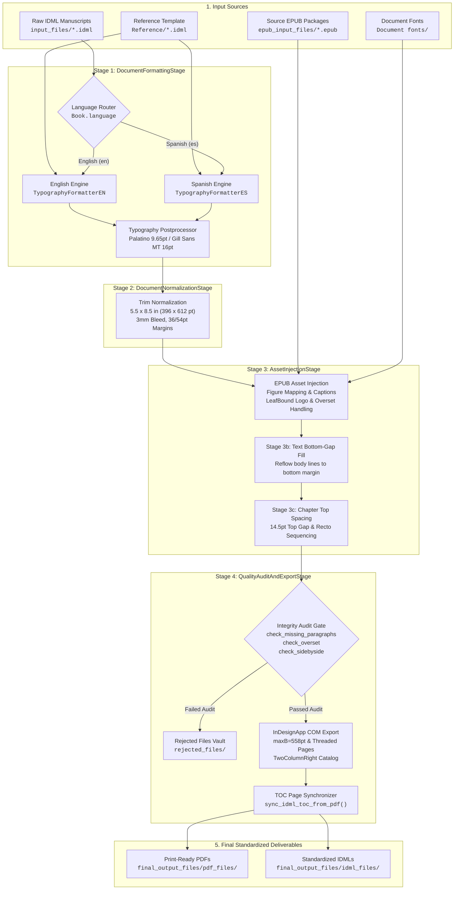

# IDML Automation Workflow: Production-Grade Dual-Language InDesign Book Publishing Pipeline

A fully autonomous, industrial-grade publishing automation system that transforms raw Adobe InDesign (`.idml`) manuscripts and EPUB packages into press-compliant, reference-matched print PDFs and standardized IDML books.

Engineered specifically for dual-language book production (**Spanish** and **English**), this repository automates typographic normalization, page geometry standardization, EPUB asset and caption injection, vertical gap elimination, rigid chapter top alignment, frontmatter balancing, and overset resolution with **zero footer collisions**, **zero dropped content**, and **correct two-page reader spreads**.

---

## Table of Contents

1. [Architectural Overview & Clarifications](#architectural-overview--clarifications)
   - [What is "Pipeline" vs "Book Workflow"?](#what-is-pipeline-vs-book-workflow)
   - [Why was `core` duplicated previously? (Resolved)](#why-was-core-duplicated-previously-resolved)
   - [Object-Oriented Programming (OOP) Architecture](#object-oriented-programming-oop-architecture)
2. [Key Features & Production Guarantees](#key-features--production-guarantees)
3. [End-to-End Workflow Architecture](#end-to-end-workflow-architecture)
4. [Deep-Dive: Workflow Stages](#deep-dive-workflow-stages)
   - [Stage 1: Dual-Language Typography & Formatting](#stage-1-dual-language-typography--formatting)
   - [Stage 2: Document Setup & Trim Normalization](#stage-2-document-setup--trim-normalization)
   - [Stage 3: EPUB Asset Extraction & Image/Caption Injection](#stage-3-epub-asset-extraction--imagecaption-injection)
   - [Stage 3b: Text Bottom-Gap Filling](#stage-3b-text-bottom-gap-filling)
   - [Stage 3c: Chapter Top Spacing & Frontmatter Sequencing](#stage-3c-chapter-top-spacing--frontmatter-sequencing)
   - [Stage 4: Print PDF Export, Two-Page View & Integrity Gates](#stage-4-print-pdf-export-two-page-view--integrity-gates)
5. [Recent Bug Fixes & Typographic Hardening](#recent-bug-fixes--typographic-hardening)
   - [Fix 1: Extreme Word Spacing on Letter Signatures / Soft Breaks](#fix-1-extreme-word-spacing-on-letter-signatures--soft-breaks)
   - [Fix 2: Chapter & Book Headings Ending with Years/Numbers Not Splitting](#fix-2-chapter--book-headings-ending-with-yearsnumbers-not-splitting)
   - [Fix 3: Title Page Publisher Logo Bottom-Margin Guide Snapping](#fix-3-title-page-publisher-logo-bottom-margin-guide-snapping)
   - [Fix 4: Title Page Sequential Order & Subtitle/Quote Extraction](#fix-4-title-page-sequential-order--subtitlequote-extraction)
   - [Fix 5: Dynamic Title Page Vertical Spacing & Logo Margin Clearance](#fix-5-dynamic-title-page-vertical-spacing--logo-margin-clearance)
   - [Fix 6: Single-Pass Final IDML Deliverable Generation](#fix-6-single-pass-final-idml-deliverable-generation)
6. [Publishing Specifications & Standard Matrix](#publishing-specifications--standard-matrix)
7. [Repository Directory Structure](#repository-directory-structure)
8. [Prerequisites & Installation](#prerequisites--installation)
9. [Execution & CLI Guide](#execution--cli-guide)
10. [Automated Quality Verification Suite](#automated-quality-verification-suite)

---

## Architectural Overview & Clarifications

### What is "Pipeline" vs "Book Workflow"?

In book production software, a **pipeline** or **workflow** is an automated assembly line. Just like a physical printing press takes raw sheets of paper, prints pages, folds signatures, collates sections, inserts photo plates, binds the cover, and trims the edges in strict sequential stages:
- **`book_workflow`** is the master assembly line engine.
- Instead of running disconnected, ad-hoc python scripts by hand, the workflow passes each book systematically through 4 standardized, verifiable stages:
  1. **Stage 1 (Formatting):** Typography, styles, and frontmatter.
  2. **Stage 2 (Normalization):** Standardizing trim size (5.5 × 8.5 in), facing pages, bleeds, and margins.
  3. **Stage 3 (Asset Injection):** Extracting figures and captions from EPUB archives and building tables.
  4. **Stage 4 (Quality Audit & Export):** Automated preflight checks, InDesign COM PDF generation, and TOC page synchronization.

The previous internal folder name `pipeline_engine` was renamed to **`book_workflow`** to provide an immediate, self-explanatory domain model for any publisher, engineer, or prepress operator.

---

### Why was `core` duplicated previously? (Resolved)

In earlier iterations of the repository:
1. `Scripts/core/` held 18 utility modules (XML handlers, typography postprocessors, TOC synchronizers, font managers, and ISBN lookup tables).
2. `pipeline_engine/core/` was introduced during an initial refactoring attempt with only `indesign_app.py`.

This caused confusion because developers could not tell which `core` package took precedence or where a new utility belonged.

**The Solution:**
All 19 core modules have been consolidated into a **single, unified package**:
```text
book_workflow/core/
```
The obsolete `Scripts/core/` and `pipeline_engine/core/` folders have been completely eliminated. All imports now resolve cleanly and predictably from `book_workflow.core`.

---

### Object-Oriented Programming (OOP) Architecture

The codebase enforces clean **Object-Oriented Programming (OOP)** patterns with clear encapsulation, inheritance, and separation of concerns:

#### 1. The Domain Model (`Book`)
- **Class:** `book_workflow.models.Book` (`book_workflow/models/book.py`)
- **Responsibility:** Encapsulates the entire lifecycle and state of a single book. Holds:
  - `isbn`: Unique ISBN-13 identifier.
  - `language`: Detected or assigned language (`"en"` or `"es"`).
  - `raw_idml_path`, `formatted_idml_path`, `normalized_idml_path`, `final_idml_path`, `pdf_path`.
  - `epub_path`: Discovered matching EPUB asset archive.
  - `has_stage_completed(stage_name)`: State inquiry.

#### 2. Workflow Path Registry (`WorkflowPaths`)
- **Class:** `book_workflow.paths.WorkflowPaths` (`book_workflow/paths.py`)
- **Responsibility:** Encapsulates directory resolution across environments, discovers input/output folders, and automatically registers internal subpackages into `sys.path`.

#### 3. Abstract Stage Contract (`WorkflowStage`)
- **Abstract Base Class:** `book_workflow.stages.base_stage.WorkflowStage`
- **Interface:**
  ```python
  class WorkflowStage(ABC):
      @property
      @abstractmethod
      def name(self) -> str: ...

      @abstractmethod
      def execute(self, book: Book) -> bool: ...

      def can_skip(self, book: Book) -> bool: ...
  ```
- Concrete Implementations:
  - `DocumentFormattingStage` (Stage 1)
  - `DocumentNormalizationStage` (Stage 2)
  - `AssetInjectionStage` (Stage 3)
  - `QualityAuditAndExportStage` (Stage 4)

#### 4. Master Orchestrator (`BookWorkflow`)
- **Class:** `book_workflow.workflow.BookWorkflow` (`book_workflow/workflow.py`)
- **Responsibility:** Coordinates stage execution across batches of books, handles language routing, provides progress reporting, and runs stage-by-stage or full end-to-end runs.

#### 5. COM Lifecycle Context Manager (`InDesignApp`)
- **Class:** `book_workflow.core.indesign_app.InDesignApp`
- **Responsibility:** Encapsulates Adobe InDesign Windows COM automation using Python's context manager protocol (`__enter__` and `__exit__`), ensuring clean startup, document isolation, and guaranteed release of COM references without orphan processes.

#### 6. Page Layout Hierarchy & Polymorphism
- Base class `BasePage` in `book_workflow.formatting.base_page`.
- Specialized page formatters: `TitlePage`, `CopyrightPage`, `AuthorPage`, `TableOfContentsPage`.
- Language-specific subclasses (`TitlePageEN`, `TitlePageES`, `TocPageEN`, `TocPageES`, etc.) override formatting rules cleanly via polymorphism rather than nested procedural conditionals.

---

## Key Features & Production Guarantees

- **Dual-Language Auto-Detection Engine**: Inspects document XML stories and filenames to distinguish Spanish from English manuscripts, routing each book to language-tailored typographic engines.
- **Strict Frontmatter Sequencing**:
  - **Page 1 (Recto)**: Title Page (Master: *None*)
  - **Page 2 (Verso)**: Copyright & Legal Notice (Master: *None*, centered vertically)
  - **Page 3 (Recto)**: About the Author / *Sobre la autoría* (Master: *None*)
  - **Page 4 (Verso)**: Blank separator page (Master: *None*)
  - **Page 5+ (Recto)**: Table of Contents / *Contenido* (Master: *None*)
  - **Post-TOC Balancing (dynamic)**: Chapters (and any text after the TOC) always begin on an **ODD (Recto)** page, wherever the TOC really ends. The start page comes from the real layout, not a fixed number:
    - TOC on 1 page (5) → blank page 6 → chapters from **7**
    - TOC on 2 pages (5–6) → no blank → chapters from **7**
    - TOC on 3 pages (5–7) → blank page 8 → chapters from **9**
    - TOC on 4 pages (5–8) → no blank → chapters from **9**, and so on.
- **Master Spread Isolation (dynamic)**: Frontmatter (every page before the first chapter page) has no running header/footer (`AppliedMaster="n"`). The running footer (page number + title, `A-Master`) starts exactly on the real first chapter page, so it follows the TOC length automatically.
- **Rigid Chapter Top Spacing**: All chapters start with a uniform **14.5 pt top gap** (`y0 = 86.04 pt`), eliminating heading displacement.
- **Zero Footer Collisions (`maxB = 558 pt`)**: All body text frames are strictly capped above the running footer margin (`maxB = 558 pt`), preventing overlapping text.
- **Zero Dropped Paragraphs (Threaded Page Extension)**: If terminal text frames overflow, the pipeline dynamically appends new pages with `A-Master` and threads the story cleanly to completion.
- **Acrobat Two-Page Reader Spread Alignment**: PDF catalog `/PageLayout /TwoColumnRight` and InDesign `PageLayoutOptions.TWO_UP_FACING` ensure Adobe Acrobat displays Page 1 alone on the right (Cover/Recto) and Pages 2 & 3 as facing spreads.
- **Dynamic TOC Page Synchronization**: Automatically reads actual starting page numbers from the generated PDF and updates the IDML Table of Contents with exact page numbers.

---

## End-to-End Workflow Architecture



---

## Deep-Dive: Workflow Stages

### Stage 0: Vertical Bottom Align (separate command)
**Module:** `bottom_align_text/vertical_bottom_align.py`  |  **Stage class:** `VerticalAlignStage` (`--step va`)

Run first, as its own command, on the raw `idml_input_files` manuscripts. It composes each book to its
full page count, then:
- **Full body pages** -> `VerticalJustification = JustifyAlign` with a **1 mm bottom inset**, so the last
  line meets the bottom-margin glue line.
- **Short chapter/section-end pages** -> `TopAlign`, so chapter-end text is never stretched (no extra
  vertical space between lines). Page "fullness" is derived from each frame's own measured line height;
  the single policy knob is the named `MIN_FULL_RATIO`.
- Output: `Output/vertical_bottom_align/<book>_valign.idml` (plus a `_valign_log.txt`). This is the input
  consumed by the rest of the pipeline; the `_valign` suffix is stripped internally so downstream
  formatted/exported names stay clean.

---

### Stage 1: Dual-Language Typography & Formatting
**Class:** `DocumentFormattingStage` (`book_workflow/stages/formatting_stage.py`)

- **Language Routing:** The book's stories are scanned for linguistic markers (`capítulo`, `contenido`, `sobre la autoría` vs `chapter`, `contents`, `about the author`).
- **Body Text:** Standardized to **Palatino Linotype**, `PointSize = 9.65 pt`, `Leading = 12 pt`, justified alignment with first-line indent of `18 pt`.
- **Chapter Headings:** Standardized to **Gill Sans MT**, `PointSize = 16 pt`, `Leading = 20 pt`, Bold, centered, with `KeepWithNext = 2` and `KeepLinesTogether = true`.
- **Title Page:**
  - Book title centered with optical baseline sinkage.
  - Author credit formatted:
    - English: standard Roman `"by"` credit.
    - Spanish: italic *"Por"* credit with baseline calculation aiming for target baseline `~374 pt`.
  - **Sequential Hierarchy:** Single-pass parser preserves exact manuscript sequence: Title $\rightarrow$ Subtitle $\rightarrow$ Author $\rightarrow$ Author Notes/Sub-credits (`centre_align`) $\rightarrow$ Epigraph/Quotes (`quotes_normal`) $\rightarrow$ Attribution.
  - **Dynamic Logo Clearance:** Proportional vertical spacing automatically reduces `SpaceBefore` on `"by"` / `"Por"` when post-author notes or quotes are present, guaranteeing $\ge 85\text{--}90\text{ pt}$ breathing room above the logo.
  - **Publisher Logo Guide Snapping:** Polygon is placed flush directly above the bottom margin guide line (`y = 557.41 pt`, `ItemTransform = "1 0 0 1 198.5325489776247 234.0"`).
- **Copyright Page:** Centered legal notices with automated ISBN replacement, translation attribution, and publisher branding.
- **Table of Contents:** Dot leaders (`. . . .`) with right-aligned tab stops at `324 pt` and trailing page numbers.

---

### Stage 2: Document Setup & Trim Normalization
**Class:** `DocumentNormalizationStage` (`book_workflow/stages/normalization_stage.py`)

Standardizes physical page geometry across all documents regardless of incoming source format:
- **Trim Size:** Standard US Trade 5.5 in × 8.5 in (`396 pt × 612 pt`).
- **Page Binding:** Facing Pages enabled (`DocumentPreferences.facingPages = true`).
- **Margins:** Top: `36 pt` (0.5 in), Bottom: `54 pt` (0.75 in), Inside: `36 pt` (0.5 in), Outside: `36 pt` (0.5 in).
- **Bleed Settings:** 3 mm standard industrial print bleed (`8.504 pt` / `3 mm`).

---

### Stage 3: EPUB Asset Extraction & Image/Caption Injection
**Class:** `AssetInjectionStage` (`book_workflow/stages/injection_stage.py`)

Extracts high-resolution raster and vector graphics from source `.epub` archives and injects them into the IDML:
- **Placeholder Replacement:** Replaces `###Insert` markup with native InDesign graphic rectangles.
- **Caption Placement:** Extracts caption strings from EPUB `<figcaption>` or adjacent `<p>` elements and places them directly beneath the graphic frames.
- **Side-by-Side Images:** Dynamically builds InDesign two-column table containers for paired illustrations.
- **Publisher Logo:** Injects the official LeafBound imprint logo (`LEAF-BOUND-trimmed.png`) onto the copyright page.

---

### Stage 3b: Text Bottom-Gap Filling (DISABLED)
**Module:** `text_bottom_gap_format.py`

> **Disabled:** vertical-justify now runs before injection (Stage 0), so the post-injection gap-fill is
> commented out in `injection_stage.py` and `workflow.py`. It is kept for reference and can be re-enabled
> by uncommenting `self.fill_bottom_gaps(books)`.

Analyzes page balance across all body pages:
- Identifies pages with premature paragraph breaks that leave awkward vertical white-space gaps before the bottom margin.
- Adjusts tracking, leading, and paragraph spacing within safe micro-typographic thresholds to reflow lines down to the bottom margin.
- Excludes Table of Contents and chapter-terminal pages.

---

### Stage 3c: Chapter Top Spacing & Frontmatter Sequencing
**Module:** `book_workflow/core/chapter_top_spacing.py`

- Rebuilds frontmatter sequence: Page 1 (Title), Page 2 (Copyright), Page 3 (About Author), Page 4 (Blank), Page 5 (TOC), then chapters on the next **ODD (Recto)** page.
- **No page-count estimate decides the layout.** The TOC spacer and the chapter-1 spacer carry `StartParagraph = "NextOddPage"`, so InDesign itself leaves the blank page (or none) according to how many pages the TOC really takes. The TOC text-length estimate is only a first guess for the footer master.
- **Real-layout pass (`book_workflow/core/frontmatter_flow.py`)** runs inside InDesign on the final composed document (end of injection and again before the PDF export): it finds the TOC and the first content paragraph from the actual layout, keeps the first content on its spacer's odd page, forces the TOC / first content onto an odd page if an earlier step left either on an even page, and gives pages before the first content page no master and every page from it on the body master (footer).
- The overset resolvers treat an empty **even** page before a `NextOddPage` paragraph as an intentional blank page, not a jam.
- PDF TOC sync (`toc_synchronizer.detect_toc_pages`) detects TOC pages of **any length** (dot leaders, trailing page numbers, or numbered lists) instead of a fixed page window.
- Inserts a top spacer paragraph with `SpaceBefore = 14.5 pt` so every chapter heading begins at exactly `y0 = 86.04 pt`.
- **Idempotent Page Breaks:** Spacer uses `StartParagraph = "NextPage"` on the `ParagraphStyleRange` rather than character-level breaks.

---

### Stage 4: Print PDF Export, Two-Page View & Integrity Gates
**Class:** `QualityAuditAndExportStage` (`book_workflow/stages/export_stage.py`)

- **InDesign COM Automation (`InDesignApp`):** Drives Adobe InDesign via Windows COM with automated error recovery.
- **Font Activation:** Automatically loads fonts from `Document fonts/` to prevent font substitution.
- **Text Frame Clamping (`maxB = 558 pt`):** Geometric bounds are capped at `558 pt` to prevent colliding with running footers.
- **Threaded Page Addition:** If text overflows after bounding-box adjustment, the pipeline adds new pages with `A-Master` and threads the story to completion.
- **Reader Spread Layout (`TwoColumnRight`):** Configures PDF catalog `/PageLayout /TwoColumnRight` via PyMuPDF and `PageLayoutOptions.TWO_UP_FACING`.
- **Dynamic TOC Synchronization:** Reads actual chapter heading page locations from the newly generated PDF and updates the IDML Table of Contents tab leaders, then re-exports the PDF so page numbers match the physical layout.

---

## Recent Bug Fixes & Typographic Hardening

### Fix 1: Extreme Word Spacing on Letter Signatures / Soft Breaks
- **Symptom:** In letters or signature blocks (e.g. `Signed:\u2028BLACHEVELLE...`), words and individual characters stretched across the entire width of the page with huge, unnatural gaps.
- **Root Cause:** Procedural style enforcement in `test_cases/fix_paragraph_styles.py` forcefully reassigned right-aligned or multi-line signature paragraphs to standard `body_text` (`LEFT_JUSTIFIED`). When a paragraph contains soft line breaks (`\u2028`), InDesign's layout engine justifies every line before the soft break against both margins.
- **Resolution:**
  1. Updated `test_cases/fix_paragraph_styles.py` to preserve `RIGHT[k]` and `CENTER[k]` alignments and prohibit `LEFT_JUSTIFIED` or `FULLY_JUSTIFIED` on paragraphs containing soft breaks (`\u2028` or `\n`).
  2. Updated `book_workflow/core/typography_postprocessor.py` line 912 to prevent applying `LeftJustified` to paragraphs with soft line breaks if already right- or center-aligned:
     ```python
     if _cur_just not in ("CenterAlign", "RightAlign"):
         psr.set("Justification", "LeftAlign")
     ```
  3. Preserved right/center alignment in `book_workflow/formatting/typography/typography_en.py`.

### Fix 2: Chapter & Book Headings Ending with Years/Numbers Not Splitting
- **Symptom:** In *Les Misérables* (`9789370421240`), headings like `BOOK THIRD—IN THE YEAR 1817` and `CHAPTER I—THE YEAR 1817` stayed on a single line, whereas other headings (`BOOK SECOND—THE FALL`, `CHAPTER I—THE EVENING...`) split into two centered lines as expected.
- **Root Cause:** In `book_workflow/core/chapter_heading_fix.py`, the regular expression used to skip Table of Contents page lines was:
  ```python
  re.search(r"\s\d{1,4}\s*$", txt)
  ```
  Because the heading ended with the year `1817` (a 4-digit number at the end of the line), the classifier misidentified the heading as a TOC entry and skipped the two-line split.
- **Resolution:** Replaced the greedy match with strict TOC leader / tab detection:
  ```python
  re.search(r"(\.\s*){2,}\s*\d+", txt) or re.search(r"\t\s*\d+\s*$", txt) or re.search(r"\s{3,}\d{1,4}\s*$", txt)
  ```
  Headings ending in historical years (such as `1817`) are now correctly recognized as headings and split onto two centered lines separated by `\u2028`.

### Fix 3: Title Page Publisher Logo Bottom-Margin Guide Snapping
- **Symptom:** On Page 1 (Title Page), the publisher imprint logo Polygon frame was floating ~15 pt above the bottom margin line (`y = 558 pt`) or varying inconsistently across documents.
- **Root Cause:** Multiple template generators applied disparate transformation coordinates or failed to account for polygon vertex bounds relative to the 5.5 × 8.5 in page coordinate grid.
- **Resolution:**
  1. Standardized the publisher logo Polygon transform to `ItemTransform = "1 0 0 1 198.5325489776247 234.0"` across `title_page_es.py`, `title_page_en.py`, `document_setup_impl.py`, and `chapter_spacing_styles.py`.
  2. With target polygon vertices at top `-28.35 pt` and bottom `+17.41 pt`, the logo's bottom edge sits at $y = 557.41\text{ pt}$ in page coordinates, resting exactly $0.59\text{ pt}$ flush directly above the $558\text{ pt}$ bottom margin guide line.
  3. Added dynamic margin guide calculation to `injection/logo_inject.py` to snap the logo frame directly to the spread's bottom margin line during ExtendScript injection.

### Fix 4: Title Page Sequential Order & Subtitle/Quote Extraction
- **Symptom:** In books containing both an author subtitle / sub-credit (e.g. *ENCONTRADO ENTRE LOS PAPELES DEL DIFUNTO DIEDRICH KNICKERBOCKER.*) and an epigraph / verse quote (e.g. *CASTILLO DE LA INDOLENCIA*), the subtitle was erroneously moved to the very bottom below the poem and attribution.
- **Root Cause:** In `_extract_title_parts` (`title_page_es.py` and `title_page_en.py`), a two-pass filter eagerly captured paragraphs with quote styles (`quotes_normal`) into the `epigraph` variable first. When non-quote paragraphs were subsequently scanned, post-author notes were appended to the end of `epigraph` (`epigraph += "\u2028" + txt`), inverting the document's original sequence.
- **Resolution:**
  1. Refactored `_extract_title_parts` to single-pass sequential document order:
     $$\text{Title} \longrightarrow \text{Subtitle (if before author)} \longrightarrow \text{Author line} \longrightarrow \text{Author notes / sub-credits} \longrightarrow \text{Epigraph / Quotes} \longrightarrow \text{Attribution}$$
  2. Text appearing between the author and quotes is now preserved as author sub-credits (`centre_align` style, 11 pt, Times New Roman, centered), placed directly below the author name before any epigraphs or quotes.

### Fix 5: Dynamic Title Page Vertical Spacing & Logo Margin Clearance
- **Symptom:** When a book had multiple lines of text below the author (notes, poems, quotes), the fixed `SpaceBefore` on `"by"` / `"Por"` (aiming for baseline $\sim 374\text{ pt}$) pushed the entire text block down until it collided with the publisher logo at the bottom margin.
- **Root Cause:** The title page spacing model assumed books only contain Title and Author, leaving insufficient vertical clearance for manuscripts with lengthy quotes or sub-credits.
- **Resolution:**
  In `book_workflow/core/chapter_spacing_styles.py` (`format_title_story`), implemented dynamic line counting and proportional vertical clearance:
  - **Books with NO text below the author** (e.g. Book 18670): keeps standard baseline $\sim 374\text{ pt}$ with generous breathing room below the author.
  - **Books WITH extra lines below author** (e.g. Book 739): calculates total height of sub-credits, quotes, and attributions, and dynamically reduces `SpaceBefore` on `"by"` / `"Por"` (e.g. from $180\text{ pt}$ down to $94\text{ pt}$) to anchor the text block higher on the page and guarantee a clean open margin ($\ge 85\text{--}90\text{ pt}$) above the publisher logo.

### Fix 6: Single-Pass Final IDML Deliverable Generation
- **Symptom:** The final output directory contained duplicate intermediate files (`<ISBN>_injected.idml` and `<ISBN>.idml`).
- **Resolution:** Cleaned export routines in `export_stage.py` and injection helpers to save the final IDML directly to its standardized ISBN name in a single pass without leaving lingering `*_injected.idml` files.

---

## Publishing Specifications & Standard Matrix

| Specification | Target Value | Technical Implementation |
|:---|:---|:---|
| **Trim Size** | 5.5 × 8.5 in (396 × 612 pt) | `DocumentPreferences.pageWidth = 396`, `pageHeight = 612` |
| **Bleed** | 3 mm (8.504 pt) | `documentBleedTopOffset = 8.504 pt` (all sides) |
| **Page Margins** | Top: 36 pt, Bottom: 54 pt, Inside: 36 pt, Outside: 36 pt | `MarginPreference` on Spread Pages |
| **Body Font** | Palatino Linotype, Regular, 9.65 pt | `AppliedFont = "Palatino Linotype"`, `PointSize = 9.65`, `Leading = 12` |
| **Heading Font** | Gill Sans MT, Bold, 16 pt | `AppliedFont = "Gill Sans MT"`, `PointSize = 16`, `Leading = 20` |
| **Chapter Top Gap** | 14.5 pt (`y0 = 86.04 pt`) | Spacer PSR + `SpaceBefore = 14.5 pt`, `SpaceAfter = 30 pt` |
| **Max Frame Bottom** | 558 pt (Margin Bottom: 558 pt) | Geometric bounds capped at 558 pt; 0 footer collisions |
| **Title Page Logo** | Directly above bottom margin line ($y = 557.41\text{ pt}$) | `ItemTransform = "1 0 0 1 198.5325489776247 234.0"` |
| **Footer Line** | Running header/footer at y = 576.45 pt | Defined on `A-Master`; isolated from frontmatter |
| **TOC Leader** | Right-aligned dot leader (`. . . .`) at 324 pt | `TabList` RightAlign tab at position `324` with leader `.` |
| **Content Start** | Always Recto (Page 7 or next Odd) | Automated post-TOC blank page balancing |
| **PDF Catalog** | Two-Page Facing Spreads | `/PageLayout /TwoColumnRight` |

---

## Repository Directory Structure

```text
idml_automation/
├── README.md                                # Master documentation
├── requirements.txt                         # Python dependencies
├── run_book_pipeline.py                     # Primary CLI runner (reads Output/vertical_bottom_align)
├── bottom_align_text/                       # Step 0: vertical bottom-align (separate command)
│   ├── __init__.py
│   └── vertical_bottom_align.py             # Bottom-align body -> Output/vertical_bottom_align/<book>_valign.idml
├── run_chapter_top_spacing.py               # Chapter top spacing runner
├── text_bottom_gap_format.py                # Stage 3b: Bottom gap reflow engine
├── measure_page_gaps.py                     # Quality audit tool: measures page gaps
├── pdf_export.py                            # PDF export module
├── check_captions_all.py                    # Caption checker across books
├── idml_input_files/                        # Input: Raw IDML manuscripts (English & Spanish)
├── epub_input_files/                        # Input: Source EPUB packages (images & captions)
├── Reference/                               # Reference layout templates
├── Fonts/                                   # Embedded fonts (Palatino Linotype, Gill Sans MT, etc.)
├── logo/                                    # Publisher logos (LEAF-BOUND, etc.)
│
├── book_workflow/                           # Clean OOP Workflow Package
│   ├── __init__.py
│   ├── workflow.py                          # BookWorkflow master orchestrator class
│   ├── paths.py                             # WorkflowPaths registry
│   ├── book_discovery.py                    # Discovers Book instances from input directories
│   │
│   ├── models/                              # Domain entity models
│   │   ├── __init__.py
│   │   └── book.py                          # Book domain model (ISBN, paths, status, language)
│   │
│   ├── stages/                              # OOP Stage implementations
│   │   ├── __init__.py
│   │   ├── base_stage.py                    # Abstract WorkflowStage base class (prints i/N progress)
│   │   ├── vertical_align_stage.py          # Step va: VerticalAlignStage (--step va)
│   │   ├── formatting_stage.py              # Stage 1: DocumentFormattingStage
│   │   ├── normalization_stage.py           # Stage 2: DocumentNormalizationStage
│   │   ├── injection_stage.py               # Stage 3: AssetInjectionStage
│   │   └── export_stage.py                  # Stage 4: QualityAuditAndExportStage
│   │
│   ├── core/                                # Consolidated publishing core
│   │   ├── indesign_app.py                  # InDesignApp COM context manager
│   │   ├── font_manager.py                  # Font discovery & validation
│   │   ├── isbn_manager.py                  # ISBN lookup & metadata manager
│   │   ├── idml_utils.py                    # Low-level IDML XML & zip manipulation helpers
│   │   ├── typography_postprocessor.py      # Typography standardization & soft-break fixes
│   │   ├── chapter_heading_fix.py           # 2-line heading splitting (fixed year matching)
│   │   ├── chapter_top_spacing.py           # 14.5pt top gap & frontmatter sequencer
│   │   ├── frontmatter_flow.py              # Real-layout front-matter pass (odd-page chapters, footer from first chapter page)
│   │   ├── toc_synchronizer.py              # PDF-to-IDML TOC page number synchronizer (dynamic TOC page detection)
│   │   └── ... (all publishing core modules)
│   │
│   ├── config/                              # Language and pipeline configuration
│   │   ├── language_config.py
│   │   └── languages.py
│   │
│   └── formatting/                          # Modular typography & page formatters
│       ├── base_page.py                     # BasePage abstract class
│       ├── book_formatter.py                # Formatter coordinator
│       ├── title/                           # Title page implementations (EN & ES)
│       ├── copyright/                       # Copyright page implementations (EN & ES)
│       ├── author/                          # About the Author page implementations (EN & ES)
│       ├── table_of_contents/               # TOC page implementations (EN & ES)
│       └── typography/                      # Typography formatters (EN & ES)
│
├── injection/                               # EPUB image extraction & caption injection
│   ├── inject_with_epub_captions.py
│   ├── epub_caption_apply.py
│   ├── image_layout_format.py
│   └── logo_inject.py
│
├── table/                                   # Table layout and fitting
│   └── table_fit_format.py
│
├── test_cases/                              # Automated quality audit verification suite
│   ├── audit.py                             # Master audit runner
│   ├── check_missing_paragraphs.py          # Reconciles text against original source
│   ├── check_overset.py                     # Detects overset text frames
│   ├── check_sidebyside.py                  # Verifies side-by-side image tables
│   ├── check_caption.py                     # Audits image caption styling
│   ├── check_bleed.py                       # Verifies 3mm print bleeds
│   ├── check_word_spacing_and_block.py      # Scans for loose justification
│   └── paragraph_styles_format.py           # Alignment guard & justification fix
│
├── Output/                                  # Intermediate pipeline artifacts
│   ├── vertical_bottom_align/               # Step 0 output: <book>_valign.idml (pipeline input)
│   ├── Formatted/
│   ├── page_resize_output/
│   ├── injected_idml_files/
│   └── pdf_files/
│
└── final_output_files/                      # Production deliverable folder
    ├── idml_files/                          # Standardized IDML deliverables
    ├── pdf_files/                           # Print-ready PDFs
    └── rejected_files/                      # Quarantine folder with audit failure reasons
```

---

## Prerequisites & Installation

### System Requirements
- **Operating System:** Windows 10 or Windows 11 (64-bit)
- **Python:** Python 3.10+ (ensure `python` and `pip` are on system `PATH`)
- **Desktop Application:** **Adobe InDesign 2024 or 2025** (installed and run at least once to register Windows COM Type Libraries)

### Setup Instructions
1. Clone the repository:
   ```bash
   git clone https://github.com/sumandouble9-bit/idml_automation.git
   cd idml_automation
   ```
2. Install Python dependencies:
   ```bash
   pip install -r requirements.txt
   ```

---

## Execution & CLI Guide

Production runs in **two commands**. First, vertical bottom-align the raw manuscripts; then run the main pipeline, which consumes the aligned output.

### Step 0 - Vertical Bottom Align (separate command)

```powershell
# Bottom-align the body text of the raw input (idml_input_files) and write the aligned copy to
# Output/vertical_bottom_align/<book>_valign.idml. Front matter is untouched; full body pages justify
# to a 1mm bottom inset (text meets the glue line); short chapter/section-end pages are top-aligned so
# their text is never stretched. Omit the id to align every book.
python bottom_align_text/vertical_bottom_align.py 9789370421240
python bottom_align_text/vertical_bottom_align.py
```

### Step 1-4 - Main Pipeline (Recommended)

`run_book_pipeline.py` reads its input from **`Output/vertical_bottom_align/`** (the `<book>_valign.idml`
files produced above; the `_valign` suffix is stripped internally so formatted/exported names stay clean)
and runs formatting -> normalization -> image injection -> PDF export. Every step prints an `i/N`
file-count so progress is visible in the terminal.

```powershell
# Run a single book end-to-end by ISBN or filename:
python run_book_pipeline.py 9789370421240

```

### Batch & Stage Execution Options

```powershell
# Process all aligned books end-to-end:
python run_book_pipeline.py

# Execute a specific stage only:
python run_book_pipeline.py 9789370421240 --step va  # Vertical bottom-align (also the standalone command above)
python run_book_pipeline.py 9789370421240 --step 1   # Stage 1: Formatting
python run_book_pipeline.py 9789370421240 --step 2   # Stage 2: Normalization
python run_book_pipeline.py 9789370421240 --step 3   # Stage 3: Asset Injection
python run_book_pipeline.py 9789370421240 --step 4   # Stage 4: PDF Export & Audit

# Filter by language:
python run_book_pipeline.py --lang es
python run_book_pipeline.py --lang en

# Force reprocessing even if intermediate files already exist:
python run_book_pipeline.py 9789370421240 --force
```

> Note: vertical bottom-align is **not** part of `--step all`; it is a separate command (also reachable
> via `--step va`). The post-injection gap-fill (Stage 3b) is **disabled**, because vertical-justify now
> runs before injection.

---

## Automated Quality Verification Suite

Before exporting production deliverables, documents pass through automated integrity gates located in `test_cases/`:

- **Missing Paragraph Audit (`check_missing_paragraphs.py`)**: Reconciles the plain text of the output IDML against the original raw IDML to guarantee **zero lost paragraphs**.
- **Overset Frame Detection (`check_overset.py`)**: Verifies that no text frames have remaining overset text (`tf.overflows == false`).
- **Word Spacing & Block Audit (`check_word_spacing_and_block.py`)**: Scans for loose justification, over-stretched word spacing, and unintended justification on signature lines.
- **Side-by-Side Image Pairing (`check_sidebyside.py`)**: Confirms that paired EPUB figures are placed in two-column table layouts rather than stacked vertically.
- **Caption Association (`check_caption.py`)**: Ensures every image is followed by its corresponding centered caption.
- **Quarantine Handling**: Any book that fails an audit gate is routed to `final_output_files/rejected_files/` with a detailed `.reasons.txt` log.
