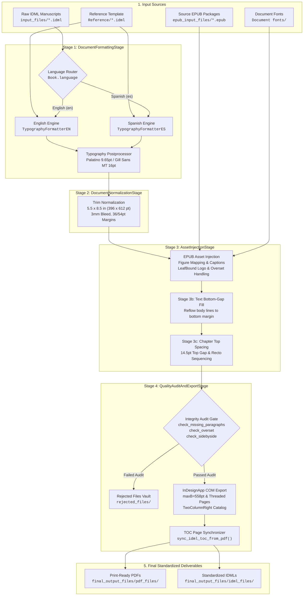

# IDML Automation Workflow: Production-Grade Dual-Language InDesign Book Publishing Pipeline

A fully autonomous, industrial-grade publishing automation system that transforms raw Adobe InDesign (`.idml`) manuscripts and EPUB packages into press-compliant, reference-matched print PDFs and standardized IDML books.

Engineered specifically for dual-language book production (**Spanish** and **English**), this repository automates typographic normalization, page geometry standardization, EPUB asset and caption injection, vertical gap elimination, rigid chapter top alignment, frontmatter balancing, and overset resolution with **zero footer collisions**, **zero dropped content**, and **correct two-page reader spreads**.

---

## Table of Contents

1. [Architectural Overview & Clarifications](#architectural-overview--clarifications)
   - [What is "Pipeline" vs "Book Workflow"?](#what-is-pipeline-vs-book-workflow)
   - [Why was `core` duplicated previously? (Resolved)](#why-was-core-duplicated-previously-resolved)
   - [Object-Oriented Programming (OOP) Architecture](#object-oriented-programming-oop-architecture)
2. [Key Features & Production Guarantees](#key-features--production-guarantees)
3. [End-to-End Workflow Architecture](#end-to-end-workflow-architecture)
4. [Deep-Dive: Workflow Stages](#deep-dive-workflow-stages)
   - [Stage 1: Dual-Language Typography & Formatting](#stage-1-dual-language-typography--formatting)
   - [Stage 2: Document Setup & Trim Normalization](#stage-2-document-setup--trim-normalization)
   - [Stage 3: EPUB Asset Extraction & Image/Caption Injection](#stage-3-epub-asset-extraction--imagecaption-injection)
   - [Stage 3b: Text Bottom-Gap Filling](#stage-3b-text-bottom-gap-filling)
   - [Stage 3c: Chapter Top Spacing & Frontmatter Sequencing](#stage-3c-chapter-top-spacing--frontmatter-sequencing)
   - [Stage 4: Print PDF Export, Two-Page View & Integrity Gates](#stage-4-print-pdf-export-two-page-view--integrity-gates)
5. [Recent Bug Fixes & Typographic Hardening](#recent-bug-fixes--typographic-hardening)
   - [Fix 1: Extreme Word Spacing on Letter Signatures / Soft Breaks](#fix-1-extreme-word-spacing-on-letter-signatures--soft-breaks)
   - [Fix 2: Chapter & Book Headings Ending with Years/Numbers Not Splitting](#fix-2-chapter--book-headings-ending-with-yearsnumbers-not-splitting)
6. [Publishing Specifications & Standard Matrix](#publishing-specifications--standard-matrix)
7. [Repository Directory Structure](#repository-directory-structure)
8. [Prerequisites & Installation](#prerequisites--installation)
9. [Execution & CLI Guide](#execution--cli-guide)
10. [Automated Quality Verification Suite](#automated-quality-verification-suite)

---

## Architectural Overview & Clarifications

### What is "Pipeline" vs "Book Workflow"?

In book production software, a **pipeline** or **workflow** is an automated assembly line. Just like a physical printing press takes raw sheets of paper, prints pages, folds signatures, collates sections, inserts photo plates, binds the cover, and trims the edges in strict sequential stages:
- **`book_workflow`** is the master assembly line engine.
- Instead of running disconnected, ad-hoc python scripts by hand, the workflow passes each book systematically through 4 standardized, verifiable stages:
  1. **Stage 1 (Formatting):** Typography, styles, and frontmatter.
  2. **Stage 2 (Normalization):** Standardizing trim size (5.5 × 8.5 in), facing pages, bleeds, and margins.
  3. **Stage 3 (Asset Injection):** Extracting figures and captions from EPUB archives and building tables.
  4. **Stage 4 (Quality Audit & Export):** Automated preflight checks, InDesign COM PDF generation, and TOC page synchronization.

The previous internal folder name `pipeline_engine` was renamed to **`book_workflow`** to provide an immediate, self-explanatory domain model for any publisher, engineer, or prepress operator.

---

### Why was `core` duplicated previously? (Resolved)

In earlier iterations of the repository:
1. `Scripts/core/` held 18 utility modules (XML handlers, typography postprocessors, TOC synchronizers, font managers, and ISBN lookup tables).
2. `pipeline_engine/core/` was introduced during an initial refactoring attempt with only `indesign_app.py`.

This caused confusion because developers could not tell which `core` package took precedence or where a new utility belonged.

**The Solution:**
All 19 core modules have been consolidated into a **single, unified package**:
```text
book_workflow/core/
```
The obsolete `Scripts/core/` and `pipeline_engine/core/` folders have been completely eliminated. All imports now resolve cleanly and predictably from `book_workflow.core`.

---

### Object-Oriented Programming (OOP) Architecture

The codebase enforces clean **Object-Oriented Programming (OOP)** patterns with clear encapsulation, inheritance, and separation of concerns:

#### 1. The Domain Model (`Book`)
- **Class:** `book_workflow.models.Book` (`book_workflow/models/book.py`)
- **Responsibility:** Encapsulates the entire lifecycle and state of a single book. Holds:
  - `isbn`: Unique ISBN-13 identifier.
  - `language`: Detected or assigned language (`"en"` or `"es"`).
  - `raw_idml_path`, `formatted_idml_path`, `normalized_idml_path`, `final_idml_path`, `pdf_path`.
  - `epub_path`: Discovered matching EPUB asset archive.
  - `has_stage_completed(stage_name)`: State inquiry.

#### 2. Workflow Path Registry (`WorkflowPaths`)
- **Class:** `book_workflow.paths.WorkflowPaths` (`book_workflow/paths.py`)
- **Responsibility:** Encapsulates directory resolution across environments, discovers input/output folders, and automatically registers internal subpackages into `sys.path`.

#### 3. Abstract Stage Contract (`WorkflowStage`)
- **Abstract Base Class:** `book_workflow.stages.base_stage.WorkflowStage`
- **Interface:**
  ```python
  class WorkflowStage(ABC):
      @property
      @abstractmethod
      def name(self) -> str: ...

      @abstractmethod
      def execute(self, book: Book) -> bool: ...

      def can_skip(self, book: Book) -> bool: ...
  ```
- Concrete Implementations:
  - `DocumentFormattingStage` (Stage 1)
  - `DocumentNormalizationStage` (Stage 2)
  - `AssetInjectionStage` (Stage 3)
  - `QualityAuditAndExportStage` (Stage 4)

#### 4. Master Orchestrator (`BookWorkflow`)
- **Class:** `book_workflow.workflow.BookWorkflow` (`book_workflow/workflow.py`)
- **Responsibility:** Coordinates stage execution across batches of books, handles language routing, provides progress reporting, and runs stage-by-stage or full end-to-end runs.

#### 5. COM Lifecycle Context Manager (`InDesignApp`)
- **Class:** `book_workflow.core.indesign_app.InDesignApp`
- **Responsibility:** Encapsulates Adobe InDesign Windows COM automation using Python's context manager protocol (`__enter__` and `__exit__`), ensuring clean startup, document isolation, and guaranteed release of COM references without orphan processes.

#### 6. Page Layout Hierarchy & Polymorphism
- Base class `BasePage` in `book_workflow.formatting.base_page`.
- Specialized page formatters: `TitlePage`, `CopyrightPage`, `AuthorPage`, `TableOfContentsPage`.
- Language-specific subclasses (`TitlePageEN`, `TitlePageES`, `TocPageEN`, `TocPageES`, etc.) override formatting rules cleanly via polymorphism rather than nested procedural conditionals.

---

## Key Features & Production Guarantees

- **Dual-Language Auto-Detection Engine**: Inspects document XML stories and filenames to distinguish Spanish from English manuscripts, routing each book to language-tailored typographic engines.
- **Strict Frontmatter Sequencing**:
  - **Page 1 (Recto)**: Title Page (Master: *None*)
  - **Page 2 (Verso)**: Copyright & Legal Notice (Master: *None*, centered vertically)
  - **Page 3 (Recto)**: About the Author / *Sobre la autoría* (Master: *None*)
  - **Page 4 (Verso)**: Blank separator page (Master: *None*)
  - **Page 5+ (Recto)**: Table of Contents / *Contenido* (Master: *None*)
  - **Post-TOC Balancing**: Dynamically balances trailing blank pages to guarantee that main body content (Chapter 1) begins strictly on an **ODD (Recto, Page 7)** page.
- **Master Spread Isolation**: Frontmatter (Pages 1–6) is isolated from running headers and footers (`AppliedMaster="n"`). Body content beginning on Page 7 is linked to `A-Master`.
- **Rigid Chapter Top Spacing**: All chapters start with a uniform **14.5 pt top gap** (`y0 = 86.04 pt`), eliminating heading displacement.
- **Zero Footer Collisions (`maxB = 558 pt`)**: All body text frames are strictly capped above the running footer margin (`maxB = 558 pt`), preventing overlapping text.
- **Zero Dropped Paragraphs (Threaded Page Extension)**: If terminal text frames overflow, the pipeline dynamically appends new pages with `A-Master` and threads the story cleanly to completion.
- **Acrobat Two-Page Reader Spread Alignment**: PDF catalog `/PageLayout /TwoColumnRight` and InDesign `PageLayoutOptions.TWO_UP_FACING` ensure Adobe Acrobat displays Page 1 alone on the right (Cover/Recto) and Pages 2 & 3 as facing spreads.
- **Dynamic TOC Page Synchronization**: Automatically reads actual starting page numbers from the generated PDF and updates the IDML Table of Contents with exact page numbers.

---

## End-to-End Workflow Architecture



---

## Deep-Dive: Workflow Stages

### Stage 1: Dual-Language Typography & Formatting
**Class:** `DocumentFormattingStage` (`book_workflow/stages/formatting_stage.py`)

- **Language Routing:** The book's stories are scanned for linguistic markers (`capítulo`, `contenido`, `sobre la autoría` vs `chapter`, `contents`, `about the author`).
- **Body Text:** Standardized to **Palatino Linotype**, `PointSize = 9.65 pt`, `Leading = 12 pt`, justified alignment with first-line indent of `18 pt`.
- **Chapter Headings:** Standardized to **Gill Sans MT**, `PointSize = 16 pt`, `Leading = 20 pt`, Bold, centered, with `KeepWithNext = 2` and `KeepLinesTogether = true`.
- **Title Page:**
  - Book title centered with optical baseline sinkage.
  - Author credit formatted:
    - English: standard Roman `"by"` credit.
    - Spanish: italic *"Por"* credit with baseline calculation aiming for target baseline `~374 pt`.
- **Copyright Page:** Centered legal notices with automated ISBN replacement, translation attribution, and publisher branding.
- **Table of Contents:** Dot leaders (`. . . .`) with right-aligned tab stops at `324 pt` and trailing page numbers.

---

### Stage 2: Document Setup & Trim Normalization
**Class:** `DocumentNormalizationStage` (`book_workflow/stages/normalization_stage.py`)

Standardizes physical page geometry across all documents regardless of incoming source format:
- **Trim Size:** Standard US Trade 5.5 in × 8.5 in (`396 pt × 612 pt`).
- **Page Binding:** Facing Pages enabled (`DocumentPreferences.facingPages = true`).
- **Margins:** Top: `36 pt` (0.5 in), Bottom: `54 pt` (0.75 in), Inside: `36 pt` (0.5 in), Outside: `36 pt` (0.5 in).
- **Bleed Settings:** 3 mm standard industrial print bleed (`8.504 pt` / `3 mm`).

---

### Stage 3: EPUB Asset Extraction & Image/Caption Injection
**Class:** `AssetInjectionStage` (`book_workflow/stages/injection_stage.py`)

Extracts high-resolution raster and vector graphics from source `.epub` archives and injects them into the IDML:
- **Placeholder Replacement:** Replaces `###Insert` markup with native InDesign graphic rectangles.
- **Caption Placement:** Extracts caption strings from EPUB `<figcaption>` or adjacent `<p>` elements and places them directly beneath the graphic frames.
- **Side-by-Side Images:** Dynamically builds InDesign two-column table containers for paired illustrations.
- **Publisher Logo:** Injects the official LeafBound imprint logo (`LEAF-BOUND-trimmed.png`) onto the copyright page.

---

### Stage 3b: Text Bottom-Gap Filling
**Module:** `fix_text_bottom_gap.py`

Analyzes page balance across all body pages:
- Identifies pages with premature paragraph breaks that leave awkward vertical white-space gaps before the bottom margin.
- Adjusts tracking, leading, and paragraph spacing within safe micro-typographic thresholds to reflow lines down to the bottom margin.
- Excludes Table of Contents and chapter-terminal pages.

---

### Stage 3c: Chapter Top Spacing & Frontmatter Sequencing
**Module:** `book_workflow/core/chapter_top_spacing.py`

- Rebuilds frontmatter sequence: Page 1 (Title), Page 2 (Copyright), Page 3 (About Author), Page 4 (Blank), Page 5 (TOC), Post-TOC balancing to guarantee Chapter 1 begins on an **ODD (Recto, Page 7)** page.
- Inserts a top spacer paragraph with `SpaceBefore = 14.5 pt` so every chapter heading begins at exactly `y0 = 86.04 pt`.
- **Idempotent Page Breaks:** Spacer uses `StartParagraph = "NextPage"` on the `ParagraphStyleRange` rather than character-level breaks.

---

### Stage 4: Print PDF Export, Two-Page View & Integrity Gates
**Class:** `QualityAuditAndExportStage` (`book_workflow/stages/export_stage.py`)

- **InDesign COM Automation (`InDesignApp`):** Drives Adobe InDesign via Windows COM with automated error recovery.
- **Font Activation:** Automatically loads fonts from `Document fonts/` to prevent font substitution.
- **Text Frame Clamping (`maxB = 558 pt`):** Geometric bounds are capped at `558 pt` to prevent colliding with running footers.
- **Threaded Page Addition:** If text overflows after bounding-box adjustment, the pipeline adds new pages with `A-Master` and threads the story to completion.
- **Reader Spread Layout (`TwoColumnRight`):** Configures PDF catalog `/PageLayout /TwoColumnRight` via PyMuPDF and `PageLayoutOptions.TWO_UP_FACING`.
- **Dynamic TOC Synchronization:** Reads actual chapter heading page locations from the newly generated PDF and updates the IDML Table of Contents tab leaders, then re-exports the PDF so page numbers match the physical layout.

---

## Recent Bug Fixes & Typographic Hardening

### Fix 1: Extreme Word Spacing on Letter Signatures / Soft Breaks
- **Symptom:** In letters or signature blocks (e.g. `Signed:\u2028BLACHEVELLE...`), words and individual characters stretched across the entire width of the page with huge, unnatural gaps.
- **Root Cause:** Procedural style enforcement in `test_cases/fix_paragraph_styles.py` forcefully reassigned right-aligned or multi-line signature paragraphs to standard `body_text` (`LEFT_JUSTIFIED`). When a paragraph contains soft line breaks (`\u2028`), InDesign's layout engine justifies every line before the soft break against both margins.
- **Resolution:**
  1. Updated `test_cases/fix_paragraph_styles.py` to preserve `RIGHT[k]` and `CENTER[k]` alignments and prohibit `LEFT_JUSTIFIED` or `FULLY_JUSTIFIED` on paragraphs containing soft breaks (`\u2028` or `\n`).
  2. Updated `book_workflow/core/typography_postprocessor.py` line 912 to prevent applying `LeftJustified` to paragraphs with soft line breaks if already right- or center-aligned:
     ```python
     if _cur_just not in ("CenterAlign", "RightAlign"):
         psr.set("Justification", "LeftAlign")
     ```
  3. Preserved right/center alignment in `book_workflow/formatting/typography/typography_en.py`.

### Fix 2: Chapter & Book Headings Ending with Years/Numbers Not Splitting
- **Symptom:** In *Les Misérables* (`9789370421240`), headings like `BOOK THIRD—IN THE YEAR 1817` and `CHAPTER I—THE YEAR 1817` stayed on a single line, whereas other headings (`BOOK SECOND—THE FALL`, `CHAPTER I—THE EVENING...`) split into two centered lines as expected.
- **Root Cause:** In `book_workflow/core/chapter_heading_fix.py`, the regular expression used to skip Table of Contents page lines was:
  ```python
  re.search(r"\s\d{1,4}\s*$", txt)
  ```
  Because the heading ended with the year `1817` (a 4-digit number at the end of the line), the classifier misidentified the heading as a TOC entry and skipped the two-line split.
- **Resolution:** Replaced the greedy match with strict TOC leader / tab detection:
  ```python
  re.search(r"(\.\s*){2,}\s*\d+", txt) or re.search(r"\t\s*\d+\s*$", txt) or re.search(r"\s{3,}\d{1,4}\s*$", txt)
  ```
  Headings ending in historical years (such as `1817`) are now correctly recognized as headings and split onto two centered lines separated by `\u2028`.

---

## Publishing Specifications & Standard Matrix

| Specification | Target Value | Technical Implementation |
|:---|:---|:---|
| **Trim Size** | 5.5 × 8.5 in (396 × 612 pt) | `DocumentPreferences.pageWidth = 396`, `pageHeight = 612` |
| **Bleed** | 3 mm (8.504 pt) | `documentBleedTopOffset = 8.504 pt` (all sides) |
| **Page Margins** | Top: 36 pt, Bottom: 54 pt, Inside: 36 pt, Outside: 36 pt | `MarginPreference` on Spread Pages |
| **Body Font** | Palatino Linotype, Regular, 9.65 pt | `AppliedFont = "Palatino Linotype"`, `PointSize = 9.65`, `Leading = 12` |
| **Heading Font** | Gill Sans MT, Bold, 16 pt | `AppliedFont = "Gill Sans MT"`, `PointSize = 16`, `Leading = 20` |
| **Chapter Top Gap** | 14.5 pt (`y0 = 86.04 pt`) | Spacer PSR + `SpaceBefore = 14.5 pt`, `SpaceAfter = 30 pt` |
| **Max Frame Bottom** | 558 pt (Margin Bottom: 558 pt) | Geometric bounds capped at 558 pt; 0 footer collisions |
| **Footer Line** | Running header/footer at y = 576.45 pt | Defined on `A-Master`; isolated from frontmatter |
| **TOC Leader** | Right-aligned dot leader (`. . . .`) at 324 pt | `TabList` RightAlign tab at position `324` with leader `.` |
| **Content Start** | Always Recto (Page 7 or next Odd) | Automated post-TOC blank page balancing |
| **PDF Catalog** | Two-Page Facing Spreads | `/PageLayout /TwoColumnRight` |

---

## Repository Directory Structure

```text
idml_automation/
├── README.md                                # Master documentation
├── requirements.txt                         # Python dependencies
├── run_book_pipeline.py                     # Single Primary CLI runner (Book Production Workflow)
├── run_chapter_top_spacing.py               # Chapter top spacing runner
├── text_bottom_gap_format.py                # Stage 3b: Bottom gap reflow engine
├── measure_page_gaps.py                     # Quality audit tool: measures page gaps
├── pdf_export.py                            # PDF export module
├── check_captions_all.py                    # Caption checker across books
├── idml_input_files/                        # Input: Raw IDML manuscripts (English & Spanish)
├── epub_input_files/                        # Input: Source EPUB packages (images & captions)
├── Reference/                               # Reference layout templates
├── Fonts/                                   # Embedded fonts (Palatino Linotype, Gill Sans MT, etc.)
├── logo/                                    # Publisher logos (LEAF-BOUND, etc.)
│
├── book_workflow/                           # Clean OOP Workflow Package
│   ├── __init__.py
│   ├── workflow.py                          # BookWorkflow master orchestrator class
│   ├── paths.py                             # WorkflowPaths registry
│   ├── book_discovery.py                    # Discovers Book instances from input directories
│   │
│   ├── models/                              # Domain entity models
│   │   ├── __init__.py
│   │   └── book.py                          # Book domain model (ISBN, paths, status, language)
│   │
│   ├── stages/                              # OOP Stage implementations
│   │   ├── __init__.py
│   │   ├── base_stage.py                    # Abstract WorkflowStage base class
│   │   ├── formatting_stage.py              # Stage 1: DocumentFormattingStage
│   │   ├── normalization_stage.py           # Stage 2: DocumentNormalizationStage
│   │   ├── injection_stage.py               # Stage 3: AssetInjectionStage
│   │   └── export_stage.py                  # Stage 4: QualityAuditAndExportStage
│   │
│   ├── core/                                # Consolidated publishing core
│   │   ├── indesign_app.py                  # InDesignApp COM context manager
│   │   ├── font_manager.py                  # Font discovery & validation
│   │   ├── isbn_manager.py                  # ISBN lookup & metadata manager
│   │   ├── idml_utils.py                    # Low-level IDML XML & zip manipulation helpers
│   │   ├── typography_postprocessor.py      # Typography standardization & soft-break fixes
│   │   ├── chapter_heading_fix.py           # 2-line heading splitting (fixed year matching)
│   │   ├── chapter_top_spacing.py           # 14.5pt top gap & frontmatter sequencer
│   │   ├── toc_synchronizer.py              # PDF-to-IDML TOC page number synchronizer
│   │   └── ... (all publishing core modules)
│   │
│   ├── config/                              # Language and pipeline configuration
│   │   ├── language_config.py
│   │   └── languages.py
│   │
│   └── formatting/                          # Modular typography & page formatters
│       ├── base_page.py                     # BasePage abstract class
│       ├── book_formatter.py                # Formatter coordinator
│       ├── title/                           # Title page implementations (EN & ES)
│       ├── copyright/                       # Copyright page implementations (EN & ES)
│       ├── author/                          # About the Author page implementations (EN & ES)
│       ├── table_of_contents/               # TOC page implementations (EN & ES)
│       └── typography/                      # Typography formatters (EN & ES)
│
├── injection/                               # EPUB image extraction & caption injection
│   ├── inject_with_epub_captions.py
│   ├── epub_caption_apply.py
│   ├── image_layout_format.py
│   └── logo_inject.py
│
├── table/                                   # Table layout and fitting
│   └── table_fit_format.py
│
├── test_cases/                              # Automated quality audit verification suite
│   ├── audit.py                             # Master audit runner
│   ├── check_missing_paragraphs.py          # Reconciles text against original source
│   ├── check_overset.py                     # Detects overset text frames
│   ├── check_sidebyside.py                  # Verifies side-by-side image tables
│   ├── check_caption.py                     # Audits image caption styling
│   ├── check_bleed.py                       # Verifies 3mm print bleeds
│   ├── check_word_spacing_and_block.py      # Scans for loose justification
│   └── paragraph_styles_format.py           # Alignment guard & justification fix
│
├── Output/                                  # Intermediate pipeline artifacts
│   ├── Formatted/
│   ├── page_resize_output/
│   ├── injected_idml_files/
│   └── pdf_files/
│
└── final_output_files/                      # Production deliverable folder
    ├── idml_files/                          # Standardized IDML deliverables
    ├── pdf_files/                           # Print-ready PDFs
    └── rejected_files/                      # Quarantine folder with audit failure reasons
```

---

## Prerequisites & Installation

### System Requirements
- **Operating System:** Windows 10 or Windows 11 (64-bit)
- **Python:** Python 3.10+ (ensure `python` and `pip` are on system `PATH`)
- **Desktop Application:** **Adobe InDesign 2024 or 2025** (installed and run at least once to register Windows COM Type Libraries)

### Setup Instructions
1. Clone the repository:
   ```bash
   git clone https://github.com/sumandouble9-bit/idml_automation.git
   cd idml_automation
   ```
2. Install Python dependencies:
   ```bash
   pip install -r requirements.txt
   ```

---

## Execution & CLI Guide

The single, unified command to run the complete publishing pipeline is **`run_book_pipeline.py`**. You can run it directly from the workspace root.

### Running a Book (Recommended)

```powershell
# Run a single book end-to-end by ISBN or filename:
python run_book_pipeline.py 9789370421240

```

### Batch & Stage Execution Options

```powershell
# Process all books found in input_files/ end-to-end:
python run_book_pipeline.py

# Execute a specific stage only:
python run_book_pipeline.py 9789370421240 --step 1   # Stage 1: Formatting
python run_book_pipeline.py 9789370421240 --step 2   # Stage 2: Normalization
python run_book_pipeline.py 9789370421240 --step 3   # Stage 3: Asset Injection
python run_book_pipeline.py 9789370421240 --step 3b  # Stage 3b: Gap Fill
python run_book_pipeline.py 9789370421240 --step 4   # Stage 4: PDF Export & Audit

# Filter by language:
python run_book_pipeline.py --lang es
python run_book_pipeline.py --lang en

# Force reprocessing even if intermediate files already exist:
python run_book_pipeline.py 9789370421240 --force
```

---

## Automated Quality Verification Suite

Before exporting production deliverables, documents pass through automated integrity gates located in `test_cases/`:

- **Missing Paragraph Audit (`check_missing_paragraphs.py`)**: Reconciles the plain text of the output IDML against the original raw IDML to guarantee **zero lost paragraphs**.
- **Overset Frame Detection (`check_overset.py`)**: Verifies that no text frames have remaining overset text (`tf.overflows == false`).
- **Word Spacing & Block Audit (`check_word_spacing_and_block.py`)**: Scans for loose justification, over-stretched word spacing, and unintended justification on signature lines.
- **Side-by-Side Image Pairing (`check_sidebyside.py`)**: Confirms that paired EPUB figures are placed in two-column table layouts rather than stacked vertically.
- **Caption Association (`check_caption.py`)**: Ensures every image is followed by its corresponding centered caption.
- **Quarantine Handling**: Any book that fails an audit gate is routed to `final_output_files/rejected_files/` with a detailed `.reasons.txt` log.
