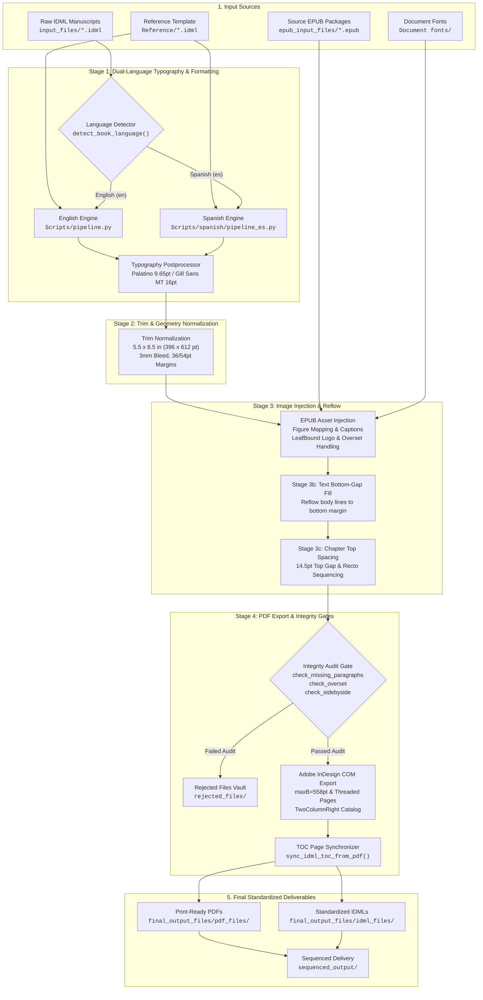

# IDML Automation Workflow: Production-Grade Dual-Language InDesign Book Publishing Pipeline

A fully autonomous, industrial-grade publishing automation pipeline that transforms raw Adobe InDesign (`.idml`) manuscripts and EPUB packages into press-compliant, reference-matched print PDFs and standardized IDML books.

Engineered specifically for dual-language book production (**Spanish** and **English**), this repository automates typographic normalization, page geometry standardization, EPUB asset and caption injection, vertical gap elimination, rigid chapter top alignment, frontmatter balancing, and overset resolution with **zero footer collisions**, **zero dropped content**, and **correct two-page reader spreads**.

---

## Table of Contents

1. [Key Features & Architectural Guarantees](#key-features--architectural-guarantees)
2. [End-to-End Pipeline Architecture](#end-to-end-pipeline-architecture)
3. [Deep-Dive: Workflow Stages](#deep-dive-workflow-stages)
   - [Stage 1: Dual-Language Typography & Formatting](#stage-1-dual-language-typography--formatting)
   - [Stage 2: Document Setup & Trim Normalization](#stage-2-document-setup--trim-normalization)
   - [Stage 3: EPUB Asset Extraction & Image/Caption Injection](#stage-3-epub-asset-extraction--imagecaption-injection)
   - [Stage 3b: Text Bottom-Gap Filling](#stage-3b-text-bottom-gap-filling)
   - [Stage 3c: Chapter Top Spacing & Frontmatter Sequencing](#stage-3c-chapter-top-spacing--frontmatter-sequencing)
   - [Stage 4: Print PDF Export, Two-Page View & Integrity Gates](#stage-4-print-pdf-export-two-page-view--integrity-gates)
4. [Publishing Specifications & Standard Matrix](#publishing-specifications--standard-matrix)
5. [Repository Directory Structure](#repository-directory-structure)
6. [Prerequisites & Installation](#prerequisites--installation)
7. [Execution & CLI Guide](#execution--cli-guide)
8. [Automated Quality Verification Suite](#automated-quality-verification-suite)
9. [Technical Notes & Engineering Solutions](#technical-notes--engineering-solutions)

---

## Key Features & Architectural Guarantees

- **Dual-Language Auto-Detection Engine**: Automatically inspects document XML stories and filenames to distinguish between Spanish and English manuscripts, routing each book to language-tailored typographic engines.
- **Strict Frontmatter Sequencing**:
  - **Page 1 (Recto)**: Title Page (Master: *None*)
  - **Page 2 (Verso)**: Copyright & Legal Notice (Master: *None*, centered vertically)
  - **Page 3 (Recto)**: About the Author / *Sobre la autoría* (Master: *None*)
  - **Page 4 (Verso)**: Blank separator page (Master: *None*)
  - **Page 5+ (Recto)**: Table of Contents / *Contenido* (Master: *None*)
  - **Post-TOC Balancing**: Dynamically balances trailing blank pages to guarantee that main body content (Chapter 1) begins strictly on an **ODD (Recto, Page 7)** page.
- **Master Spread Assignment**: Pages 1–6 are isolated from master headers/footers (`AppliedMaster="n"`). Body content beginning on Page 7 is linked to `A-Master` with running headers and folios.
- **Rigid Chapter Top Spacing**: All chapters across all titles start with a uniform **14.5 pt top gap** (`y0 = 86.04 pt`), eliminating heading displacement.
- **Zero Footer Collisions (`maxB = 558 pt`)**: All body text frames are strictly capped above the running footer margin (`maxB = 558 pt`), preventing overlapping text.
- **Zero Dropped Paragraphs (Threaded Page Extension)**: If terminal text frames overflow, the pipeline dynamically appends new pages with `A-Master` and threads the story cleanly to completion.
- **Acrobat Two-Page Reader Spread Alignment**: PDF catalog `/PageLayout /TwoColumnRight` and InDesign `PageLayoutOptions.TWO_UP_FACING` ensure Adobe Acrobat displays Page 1 alone on the right (Cover/Recto) and Pages 2 & 3 as facing spreads.
- **Dynamic TOC Page Synchronization**: Automatically reads actual starting page numbers from the generated PDF and updates the IDML Table of Contents with exact page numbers.
- **Automatic ISBN Management & Standardized Renaming**: Integrates with master ISBN registries to format copyright pages and save standardized deliverables (`{Sr No.}_{Spanish Print ISBN-13}.idml` and `.pdf`).

---

## End-to-End Pipeline Architecture



---

## Deep-Dive: Workflow Stages

### Stage 1: Dual-Language Typography & Formatting
**Core Scripts:**
- `step1_format.py` / `run_unified_dual_pipeline.py`
- `Scripts/pipeline.py` (English)
- `Scripts/spanish/pipeline_es.py` (Spanish)
- `Scripts/core/typography_postprocessor.py`
- `Scripts/spanish/typography_postprocessor_es.py`

#### Language Routing
The document's stories are scanned for linguistic markers:
- **Spanish Markers:** `capítulo`, `contenido`, `sobre la autoría`, `prólogo`, `derechos de autor`, `por `
- **English Markers:** `chapter`, `contents`, `about the author`, `preface`, `copyright`, `published by`, `by `

#### Typography Rules
- **Body Text:** Standardized to **Palatino Linotype**, `PointSize = 9.65 pt`, `Leading = 12 pt`, justified alignment with first-line indent of `18 pt`.
- **Chapter Headings:** Standardized to **Gill Sans MT**, `PointSize = 16 pt`, `Leading = 20 pt`, Bold, centered, with `KeepWithNext = 2` and `KeepLinesTogether = true`.
- **Title Page:**
  - Book title centered with optical baseline sinkage.
  - Author credit formatted:
    - English: standard Roman `"by"` credit.
    - Spanish: italic *"Por"* credit with baseline calculation aiming for target baseline `~374 pt`.
- **Copyright Page:** Centered legal notices with automated ISBN replacement, translation attribution, and publisher branding.
- **Table of Contents:** Dot leaders (`. . . .`) with right-aligned tab stops at `324 pt` and trailing page numbers.

---

### Stage 2: Document Setup & Trim Normalization
**Core Scripts:**
- `step2_normalize.py`
- `Scripts/pages/normalize_document_setup.py`

Standardizes physical page geometry across all documents regardless of incoming source format:
- **Trim Size:** Standard US Trade 5.5 in × 8.5 in (`396 pt × 612 pt`).
- **Page Binding:** Facing Pages enabled (`DocumentPreferences.facingPages = true`).
- **Margins:**
  - Top Margin: `36 pt` (0.5 in)
  - Bottom Margin: `54 pt` (0.75 in)
  - Inside (Gutter) Margin: `36 pt` (0.5 in)
  - Outside Margin: `36 pt` (0.5 in)
- **Bleed Settings:** 3 mm standard industrial print bleed (`8.504 pt` / `3 mm`).

---

### Stage 3: EPUB Asset Extraction & Image/Caption Injection
**Core Scripts:**
- `step3_inject_images.py`
- `image_inject/inject_with_epub_captions.py`
- `image_inject/epub_caption_apply.py`
- `image_inject/fix_table_fit.py`

Extracts high-resolution raster and vector graphics from source `.epub` archives and injects them into the IDML:
- **Placeholder Replacement:** Replaces `###Insert` markup with native InDesign graphic rectangles.
- **Caption Placement:** Extracts caption strings from EPUB `<figcaption>` or adjacent `<p>` elements and places them directly beneath the graphic frames.
- **Side-by-Side Images:** Dynamically builds InDesign two-column table containers for paired illustrations.
- **Publisher Logo:** Injects the official LeafBound imprint logo (`LEAF-BOUND-trimmed.png`) onto the copyright page.

---

### Stage 3b: Text Bottom-Gap Filling
**Core Script:** `fix_text_bottom_gap.py`

Analyzes page balance across all body pages:
- Identifies pages with premature paragraph breaks that leave awkward vertical white-space gaps before the bottom margin.
- Adjusts tracking, leading, and paragraph spacing within safe micro-typographic thresholds to reflow lines down to the bottom margin.
- Excludes Table of Contents and chapter-terminal pages.

---

### Stage 3c: Chapter Top Spacing & Frontmatter Sequencing
**Core Scripts:**
- `run_chapter_top_spacing.py`
- `Scripts/core/chapter_top_spacing.py`

#### Frontmatter Resequencing
Rebuilds the frontmatter sequence to conform strictly to professional book publishing standards:
1. **Page 1 (Recto)**: Title Page (Master: *None*)
2. **Page 2 (Verso)**: Copyright Page (Master: *None*)
3. **Page 3 (Recto)**: About the Author / *Sobre la autoría* (Master: *None*)
4. **Page 4 (Verso)**: Blank Page (Master: *None*)
5. **Page 5+ (Recto)**: Table of Contents / *Contenido* (Master: *None*)
6. **Post-TOC Balancing**: If TOC ends on an odd page, leaves the next even page blank so body content starts on an **ODD (Recto, Page 7)** page.

#### Chapter Heading Spacing & Idempotence
- Inserts a top spacer paragraph with `SpaceBefore = 14.5 pt` so every chapter heading begins at exactly `y0 = 86.04 pt`.
- **Idempotent Page Breaks:** Subsequent chapter spacers use `StartParagraph = "NextPage"` on the `ParagraphStyleRange` rather than character-level breaks (`ParagraphBreakType`). This guarantees that if a preceding chapter naturally fills a page down to the bottom margin, InDesign does **not** generate an accidental blank page.

---

### Stage 4: Print PDF Export, Two-Page View & Integrity Gates
**Core Scripts:**
- `step4_export_pdf.py`
- `Scripts/convert_to_pdf.py`
- `Scripts/core/toc_synchronizer.py`

#### Adobe InDesign COM Automation
Drives Adobe InDesign via Windows COM (`win32com.client`) with automated error recovery:
- **Font Activation:** Automatically loads fonts from `Document fonts/` to prevent font substitution.
- **Text Frame Clamping (`maxB = 558 pt`)**: Geometric bounds are capped at `558 pt` to prevent colliding with running footers.
- **Threaded Page Addition:** If text overflows after bounding-box adjustment, the pipeline adds new pages with `A-Master` and threads the story to completion.

#### Reader Spread Layout (`TwoColumnRight`)
Configures the exported PDF catalog:
- InDesign Export: `app.pdfExportPreferences.pageLayout = PageLayoutOptions.TWO_UP_FACING;`
- PDF Catalog Patch: `doc.set_pagelayout("/TwoColumnRight")` via PyMuPDF.
- **Result:** In Adobe Acrobat Two-Page view, Page 1 displays by itself on the right (Cover/Title), while Pages 2 & 3 display as facing pages.

#### Dynamic TOC Synchronization
Reads actual chapter heading page locations from the newly generated PDF and updates the IDML Table of Contents tab leaders, then re-exports the PDF so page numbers match the physical layout.

---

## Publishing Specifications & Standard Matrix

| Specification | Target Value | Technical Implementation |
|:---|:---|:---|
| **Trim Size** | 5.5 × 8.5 in (396 × 612 pt) | `DocumentPreferences.pageWidth = 396`, `pageHeight = 612` |
| **Bleed** | 3 mm (8.504 pt) | `documentBleedTopOffset = 8.504 pt` (all sides) |
| **Page Margins** | Top: 36 pt, Bottom: 54 pt, Inside: 36 pt, Outside: 36 pt | `MarginPreference` on Spread Pages |
| **Body Font** | Palatino Linotype, Regular, 9.65 pt | `AppliedFont = "Palatino Linotype"`, `PointSize = 9.65`, `Leading = 12` |
| **Heading Font** | Gill Sans MT, Bold, 16 pt | `AppliedFont = "Gill Sans MT"`, `PointSize = 16`, `Leading = 20` |
| **Chapter Top Gap** | 14.5 pt (`y0 = 86.04 pt`) | Spacer PSR + `SpaceBefore = 14.5 pt`, `SpaceAfter = 30 pt` |
| **Max Frame Bottom** | 558 pt (Margin Bottom: 558 pt) | Geometric bounds capped at 558 pt; 0 footer collisions |
| **Footer Line** | Running header/footer at y = 576.45 pt | Defined on `A-Master`; isolated from frontmatter |
| **TOC Leader** | Right-aligned dot leader (`. . . .`) at 324 pt | `TabList` RightAlign tab at position `324` with leader `.` |
| **Content Start** | Always Recto (Page 7 or next Odd) | Automated post-TOC blank page balancing |
| **PDF Catalog** | Two-Page Facing Spreads | `/PageLayout /TwoColumnRight` |

---

## Repository Directory Structure

```text
idml_automation_workflow/
├── run_unified_dual_pipeline.py    # Master runner for end-to-end dual-language publishing
├── run_chapter_top_spacing.py      # Standalone runner for Chapter Top Spacing & Sequencing
├── normalize_docs.py               # Standalone runner for Document Setup Normalization
├── requirements.txt                # Python environment dependencies
├── Document fonts/                 # Embedded fonts (Palatino Linotype, Gill Sans MT, etc.)
│
├── input_files/                    # Input: Raw IDML manuscripts (English & Spanish)
├── epub_input_files/               # Input: Source EPUB packages (images & captions)
│
├── idml_automation_workflow/
│   ├── run_pipeline.py             # Pipeline execution entry point
│   ├── fix_text_bottom_gap.py      # Stage 3b: Bottom gap reflow engine
│   ├── measure_page_gaps.py        # Quality audit tool: measures page gaps and image bounds
│   │
│   ├── Scripts/
│   │   ├── convert_to_pdf.py       # Adobe InDesign COM export engine & overset resolver
│   │   ├── pipeline.py             # English formatting coordinator
│   │   ├── core/
│   │   │   ├── chapter_top_spacing.py      # 14.5pt chapter spacing & frontmatter sequencer
│   │   │   ├── typography_postprocessor.py # English typography normalization
│   │   │   ├── toc_synchronizer.py         # PDF-to-IDML TOC page number synchronizer
│   │   │   ├── isbn_manager.py             # ISBN lookup & metadata manager
│   │   │   ├── idml_utils.py               # Low-level IDML XML & zip manipulation helpers
│   │   │   └── font_manager.py             # Font resolution and bundling
│   │   ├── pages/
│   │   │   ├── document_setup.py           # Document geometry setup
│   │   │   ├── title_page.py               # Title page layout
│   │   │   ├── copyright_page.py           # Copyright page layout
│   │   │   ├── toc_page.py                 # Table of contents formatting
│   │   │   ├── author_page.py              # About the Author page layout
│   │   │   └── normalize_document_setup.py # Page & text frame normalization
│   │   └── spanish/
│   │       ├── pipeline_es.py                  # Spanish formatting coordinator
│   │       ├── title_page_es.py                # Spanish title page ("Por" credit)
│   │       ├── copyright_page_es.py            # Spanish legal notices & ISBNs
│   │       ├── toc_page_es.py                  # Spanish "Contenido" TOC formatting
│   │       ├── author_page_es.py               # Spanish "Sobre la autoría" formatting
│   │       ├── typography_and_styles_es.py     # Spanish style definitions
│   │       └── typography_postprocessor_es.py  # Spanish typography normalization
│   │
│   ├── image_inject/
│   │   ├── inject_with_epub_captions.py    # EPUB image & caption injector
│   │   ├── epub_caption_apply.py           # Caption parsing & association
│   │   ├── fix_table_fit.py                # Table autofit and side-by-side reconstruction
│   │   ├── fix_image_layout.py             # Image positioning & margin constraints
│   │   └── logo_inject.py                  # Publisher logo injector
│   │
│   ├── test_cases/                         # Automated verification & audit gates
│   │   ├── check_missing_paragraphs.py     # Reconciles text against original source
│   │   ├── check_overset.py                # Detects overset text frames
│   │   ├── check_sidebyside.py             # Verifies side-by-side image tables
│   │   ├── check_caption.py                # Audits image caption styling
│   │   ├── check_bleed.py                  # Verifies 3mm print bleeds
│   │   └── check_word_spacing_and_block.py # Scans for loose justification
│   │
│   ├── Output/                             # Intermediate processing directory
│   │   ├── Formatted/                      # Stage 1 formatted IDMLs
│   │   └── page_resize_output/             # Stage 2 normalized IDMLs
│   │
│   └── final_output_files/                 # Production output directory
│       ├── idml_files/                     # Production IDML documents
│       ├── pdf_files/                      # High-resolution print PDFs
│       ├── renamed_output_files/           # Standardized ISBN-named deliverables
│       ├── sequenced_output/               # Sequenced IDML & PDF archives
│       └── rejected_files/                 # Quarantine folder for audit failures
```

---

## Prerequisites & Installation

### System Requirements
- **Operating System:** Windows 10 or Windows 11 (64-bit)
- **Python:** Python 3.10+ (ensure `python` and `pip` are in system `PATH`)
- **Desktop Application:** **Adobe InDesign 2024 or 2025** (installed and launched at least once to register COM Type Libraries)

### Setup Instructions
1. Clone the repository:
   ```bash
   git clone https://github.com/sumandouble9-bit/idml_automation_workflow.git
   cd idml_automation_workflow
   ```
2. Install Python dependencies:
   ```bash
   pip install -r requirements.txt
   ```

---

## Execution & CLI Guide

### 1. Unified Master Pipeline (Recommended)
Processes all books through Stages 1, 2, 3, 3b, 3c, and 4 end-to-end:

```powershell
# Process all books in input_files/
python run_unified_dual_pipeline.py

# Process a single book by identifier / ISBN:
python run_unified_dual_pipeline.py --book 1353

# Filter by language:
python run_unified_dual_pipeline.py --lang es
python run_unified_dual_pipeline.py --lang en

# Force re-processing of all stages:
python run_unified_dual_pipeline.py --force
```

### 2. Stage-by-Stage Execution

```powershell
# Stage 1: Typography & Formatting
python run_unified_dual_pipeline.py --step 1

# Stage 2: Document Setup & Geometry Normalization (5.5x8.5")
python run_unified_dual_pipeline.py --step 2

# Stage 3: EPUB Image & Caption Injection
python run_unified_dual_pipeline.py --step 3

# Stage 3b: Text Bottom-Gap Filling
python run_unified_dual_pipeline.py --step 3b

# Stage 3c: Chapter Top Spacing & Frontmatter Resequencing
python run_unified_dual_pipeline.py --step 3c

# Stage 4: High-Quality Print PDF Export & Integrity Audit
python run_unified_dual_pipeline.py --step 4
```

### 3. Standalone Chapter Top Spacing Runner

```powershell
# Apply 14.5pt chapter spacing and Recto frontmatter sequencing in-place:
python run_chapter_top_spacing.py path/to/book.idml --output-dir path/to/output --pdf
```

---

## Automated Quality Verification Suite

Before exporting production deliverables, documents pass through automated integrity gates located in `idml_automation_workflow/test_cases/`:

- **Missing Paragraph Audit (`check_missing_paragraphs.py`)**: Reconciles the plain text of the output IDML against the original raw IDML to ensure **zero lost paragraphs**.
- **Overset Frame Detection (`check_overset.py`)**: Verifies that no text frames have remaining overset text (`tf.overflows == false`).
- **Image Margins & Bleeds (`check_bleed.py`, `check_image_margins.py`)**: Checks that page items conform to the 3 mm bleed and stay within print margins.
- **Side-by-Side Image Pairing (`check_sidebyside.py`)**: Confirms that paired EPUB figures are placed in two-column table layouts rather than stacked vertically.
- **Caption Association (`check_caption.py`)**: Ensures every image is followed by its corresponding centered caption.
- **Quarantine Handling**: Any book that fails an audit gate is routed to `final_output_files/rejected_files/` with a detailed `.reasons.txt` log.

---

## Technical Notes & Engineering Solutions

### 1. Idempotent Spacing vs Unconditional Breaks
In Adobe InDesign IDML XML:
- Setting `ParagraphBreakType="NextPage"` on a `CharacterStyleRange` is an **unconditional break command**. If preceding text fills a page down to the bottom margin, the spacer paragraph flows to the top of the next page, and its `ParagraphBreakType="NextPage"` triggers a second break, creating an unwanted blank page.
- Setting `StartParagraph="NextPage"` on the `ParagraphStyleRange` is **idempotent**. If the paragraph is already at the top of a page, InDesign does not advance again. The subsequent chapter heading is set to `StartParagraph="Anywhere"` so it sits directly below the top spacer on that same page.

### 2. XML Metadata vs Content Parsing
When inspecting InDesign story XML, using `psr.itertext()` extracts text from child `<Properties>` elements (such as `<AppliedFont>Palatino Linotype</AppliedFont>` and `<Leading>12</Leading>`). The pipeline uses a strict `_get_text()` helper that parses only `<Content>` elements, preventing empty spacer paragraphs from being misidentified as having text.

### 3. Acrobat Two-Page View & PDF Catalog
Without explicit catalog preferences, Adobe Acrobat displays Page 1 on the left and Page 2 on the right in two-page view, shifting the spreads. The pipeline configures `/PageLayout /TwoColumnRight` via PyMuPDF and `PageLayoutOptions.TWO_UP_FACING` in InDesign export preferences, guaranteeing that Page 1 is displayed on the right as a cover page and Pages 2 and 3 form facing spreads.

### 4. Overset Bounding Box Clamping
To resolve text oversets without colliding with running footers, geometric bounds are strictly clamped to `maxB = 558 pt`. If content still overflows, the pipeline dynamically appends new pages with `A-Master` and threads the story to the added frames.
