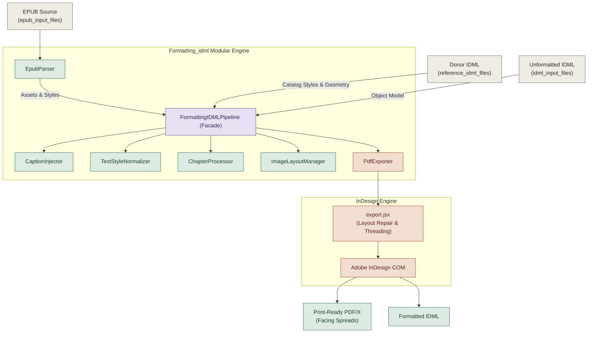

# IDML Formatting Automation — Double Nine Books

Automated, high-fidelity formatting of unformatted InDesign books (IDML) into print-ready, PDF/X-compliant publications.

This repository implements the modular **`Formatting_idml`** engine (1st Module), transitioning legacy procedural scripts into a clean, decoupled Object-Oriented Programming (OOP) architecture. It delivers authoritative EPUB-to-IDML typographic style mapping, 100% data table preservation, natural adaptive image placement without paragraph shifting, and automated Adobe InDesign COM compilation with quality gate validation.

---

## 1. Project Layout

```
idml_automation/
├── Formatting_idml/             # Core OOP Module (Typography, Captions, Images, Chapters, Export)
│   ├── __init__.py              # Public package exports
│   ├── caption_injector.py      # CaptionInjector: atomic token injection & verbatim caption resolution
│   ├── chapter_processor.py     # ChapterProcessor: chapter boundary scanner & isolated processing
│   ├── epub_parser.py           # EpubParser: asset extractor & authoritative inline style/caption parser
│   ├── image_layout_manager.py  # ImageLayoutManager: cell centering & layout rule specifications
│   ├── pdf_exporter.py          # PdfExporter: InDesign COM automation, PDF/X export & quality validation
│   ├── pipeline.py              # FormattingIDMLPipeline: unified facade orchestrator
│   └── text_style_normalizer.py # TextStyleNormalizer: typographic remap & 100% table preservation
├── bridge/                      # InDesign Automation Bridge
│   ├── indesign_runner.py       # Python-to-InDesign COM execution wrapper
│   └── jsx/                     # ExtendScript Layout & Export Scripts
│       ├── baseline.jsx         # Baseline grid alignment & even-page enforcement
│       ├── export.jsx           # Main layout engine (autoflow, image placement, table fit, PDF/X)
│       └── reflow.jsx           # Text reflow & frame expansion helper
├── epub_input_files/            # Matching EPUB source files (authoritative styles & images)
│   ├── 18670.epub
│   ├── 18722.epub
│   └── 9789361422768.epub
├── idml_input_files/            # Unformatted IDML books to format
│   ├── 18670.idml
│   ├── 18722.idml
│   └── 9789361422768.idml
├── logo/                        # Publisher imprint assets
│   ├── LEAF-BOUND-trimmed.png
│   └── LEAF-BOUND300dpi-aiwhite--&black-update.png
├── model/                       # Document Object Model
│   ├── document.py              # DocumentModel: IDML stories & spreads container
│   ├── story.py                 # StoryModel: XML story manipulator & paragraph iterator
│   └── styles.py                # StylesModel: paragraph & character styles manager
├── package/                     # IDML Archive Packaging
│   └── idml_package.py          # IDMLPackage: clean zip unpacker/packer with namespace preservation
├── reference_idml_files/        # House style donor & reference publications
│   └── reference_donor.idml     # 38-style Double Nine catalog & master page donor
├── setup/                       # Document Setup & Catalog Synchronization
│   ├── doc_setup.py             # Page geometry, margin calculations, and spread normalizers
│   └── style_transfer.py        # Transfers catalog styles & fonts from donor to target IDML
├── validate/                    # Quality Verification Suite
│   ├── rules/                   # Individual validation rule checks
│   │   ├── check_images.py      # Asserts image clarity, dimensions, and lack of clipping
│   │   ├── check_paragraph_count.py # Verifies paragraph count stability
│   │   └── check_styles.py      # Validates style resolution and orphan style cleanup
│   └── validator.py             # RuleValidator runner
├── run_formatting.py            # Unified CLI entry point for isolated chapters and full-book runs
└── README.md                    # System architecture, logic documentation, and usage guide
```

---

## 2. Architecture & OOP Class Design

The engine replaces legacy procedural scripts (`inject_with_epub_captions.py`, `fix_image_layout.py`, `epub_caption_apply.py`) with decoupled classes governed by the **Single Responsibility Principle (SRP)** and coordinated via the **Facade Pattern**.



### Class Responsibilities

| Class | Source File | Core Responsibility |
| :--- | :--- | :--- |
| **`EpubParser`** | [`Formatting_idml/epub_parser.py`](file:///Formatting_idml/epub_parser.py) | Unzips EPUB, extracts image assets, and builds an authoritative `EpubFormattingMap` containing verbatim captions, inline styles (`bold`, `italic`, `underline`), and table counts. |
| **`TextStyleNormalizer`** | [`Formatting_idml/text_style_normalizer.py`](file:///Formatting_idml/text_style_normalizer.py) | Executes typographic normalization, removes redundant empty page-break paragraphs before headings, maps EPUB bold/italic/underline spans, and strictly guards all data tables from body overrides. |
| **`CaptionInjector`** | [`Formatting_idml/caption_injector.py`](file:///Formatting_idml/caption_injector.py) | Scans for placeholder tags (`###Insert imageNNN here###`), splits packed multi-image paragraphs, maps verbatim EPUB captions, and injects structured atomic tokens (`###IMAGE_TOKEN: path=... \| cap=... \| style=...###`). |
| **`ImageLayoutManager`** | [`Formatting_idml/image_layout_manager.py`](file:///Formatting_idml/image_layout_manager.py) | Encapsulates geometric formatting specifications: centering images in table cells, stripping borders from figure tables, and sizing publisher logos. |
| **`ChapterProcessor`** | [`Formatting_idml/chapter_processor.py`](file:///Formatting_idml/chapter_processor.py) | Identifies chapter boundaries in stories, constructs `ChapterInfo` manifests, and enables isolated chapter-by-chapter formatting and debugging. |
| **`PdfExporter`** | [`Formatting_idml/pdf_exporter.py`](file:///Formatting_idml/pdf_exporter.py) | Manages InDesign COM lifecycle with automatic recovery clearing, executes `export.jsx`, validates quality gates (overset frames, image clarity), and renders high-res PNG spread previews. |
| **`FormattingIDMLPipeline`** | [`Formatting_idml/pipeline.py`](file:///Formatting_idml/pipeline.py) | Master facade uniting all components for single-chapter or whole-book processing. |

---

## 3. Key Algorithmic Logic & Formatting Rules

### A. Verbatim Caption & Style Grounding
* **Exact String Preservation**: Captions extracted from the EPUB `<figcaption>` block retain exact text verbatim without stripping `[Illustration: ...]` prefixes or brackets.
* **Exact Font Styling**: Captions are never forced to Italic. Font style attributes (`Bold`, `Regular`, `Italic`) are parsed directly from the EPUB markup and preserved 1:1 on the InDesign paragraph.
* **Adjacent Token Collision Prevention**: The figure-label cleanup loop strictly avoids clearing any paragraph containing active image placeholders (`###IMAGE_TOKEN` or `###Insert`), ensuring closely placed images never delete each other's tokens.

### B. Natural Image Placement (Zero Paragraph Shifting)
* **Exact Placeholder Placement**: Images are placed directly at their specified placeholder position without shifting paragraphs up or down.
* **Unresized Natural Scale**: Graphics are inserted at 100% natural scale using `FitOptions.FRAME_TO_CONTENT`. Artificial height squeezing is eliminated.
* **Proportional Boundary Safety**: If an image exceeds the printable column width (`colW`) or page column height (`maxH = 480 pt`), it is scaled down proportionally to prevent margin clipping.

### C. Visibility Floor & OpenCV Edge-Density Analysis
* **Goal**: Ensure text on coins, statues, engravings, and fine-line diagrams is never compressed into an illegible thumbnail during layout autoflow.
* **Logic**:
  * During asset extraction (Step 2), images undergo **OpenCV edge-density analysis** (`cv2.Canny` / Sobel gradient distribution).
  * High edge density indicates dense high-frequency information (such as engraved Latin inscriptions, fine coin details, or intricate illustrations).
  * The analysis sets an **immutable minimum size** threshold:
    - **Portrait**: $H \ge 220\text{--}260\text{ pt}$ (preventing reduction to thumbnail height).
    - **Landscape**: Full column width ($W \approx 316\text{ pt}$).
  * The image is never shrunk below this threshold.
* **Layout & Quality Gate Integration**:
  * **InDesign Layout Engine (`bridge/jsx/export.jsx`)**: When fitting an anchored image frame, InDesign asserts the rendered height never drops below this floor. If available vertical room on the page is insufficient to accommodate the minimum height, the image anchor automatically flows to the head of the following spread rather than being squeezed into an unreadable scale.
  * **Post-Layout Validation Gate (`validate/rules/check_images.py` & `PdfExporter.validate_pdf`)**: Scans each rendered image xref in the generated PDF/X to assert it meets or exceeds its assigned clarity floor, flagging any over-compressed assets in the validation report.

### D. 100% Data Table Preservation
* **Pre-Indexed Cell Protection**: Prior to applying body paragraph transforms, all table paragraphs and cells are indexed into `table_p_set`. Body style normalizers and Word override strippers strictly bypass these cells.
* **Cell Font Style & Size Retention**: Header rows maintain bold formatting; numeric and monetary data retain original point sizes, alignment, and fractional styling.
* **Multi-Row Table Page Breaking**: Body rows of multi-row data tables are configured with `row.autoGrow = true` and `row.keepWithNextRow = false`, allowing long multi-page tables (such as price schedules) to break naturally across page margins.

### E. Un-Splittable Single-Cell Table Breakdown
* In Word imports, long poems, ballads, or boxed quotes are frequently wrapped in a 1×1 single-cell table. When the poem's row height exceeds the printable page height (e.g. 585 pt vs. 522 pt page limit), InDesign cannot split a single row across pages, causing a permanent overset halt.
* The layout engine identifies single-cell text-only tables that exceed page height or overflow, and converts them to ordinary flowing text using `tb.convertToText("\t", "\r")`. This restores the poem lines to normal flowing paragraphs matching the EPUB `<blockquote>` structure, allowing them to flow cleanly across spreads.

### F. Redundant Chapter Page-Break Purge
* In Word-generated IDML files, empty paragraphs with `PageBreak` or forced break characters often precede chapter headings, causing unwanted blank pages.
* The normalizer safely scans the 3 paragraphs immediately preceding each `chapter_name` or `heading_1` paragraph. If an empty paragraph contains only a page-break character or whitespace, it is removed without altering body text flow.

### G. Page Threading & Overset Resolution
* During layout repair in InDesign, the engine checks both `lastTf.overflows` and `story.overflows`.
* New pages with `A-Master` are dynamically appended and threaded until all story text has flowed cleanly with zero overset text frames. Single-frame frontmatter stories (e.g. title or copyright) are safeguarded against accidental runaway threading.
* Total document page count is automatically rounded to an even number to satisfy two-page facing print spread requirements.

---

## 4. CLI Usage & Commands

The pipeline is invoked via [`run_formatting.py`](file:///run_formatting.py).

### 1. List Chapters Manifest
Inspect the chapter structure, paragraph count, image count, and table count of any book:
```bash
python run_formatting.py --book 18670 --list-chapters
python run_formatting.py --book 9789361422768 --list-chapters
```

### 2. Isolated Chapter Mode (Rapid Debugging)
Format a single chapter in isolation without waiting for a 300-page book compilation:
```bash
# Pure Python XML formatting (runs in ~1-2 seconds, no InDesign required)
python run_formatting.py --book 18670 --chapter 1 --skip-jsx

# Full compilation with InDesign layout repair & PDF export
python run_formatting.py --book 18670 --chapter 1
```

### 3. Full Book Mode
Process all chapters across the entire book:
```bash
# Pure Python normalization
python run_formatting.py --book 18722 --all --skip-jsx

# Full pipeline: XML normalization + InDesign layout repair + PDF/X export
python run_formatting.py --book 18670 --all
python run_formatting.py --book 18722 --all
python run_formatting.py --book 9789361422768 --all
```

### 4. High-Resolution Spread Previews
Render specific page spreads to high-resolution PNG images for visual inspection:
```bash
python run_formatting.py --book 18722 --preview-pages 7 8 26 217 225
```

---

## 5. Verified Benchmark Books

The modular pipeline has been validated across three distinct production titles:

| Book ID | Title / Content | Characteristics | Pipeline Results |
| :--- | :--- | :--- | :--- |
| **`18670`** | *Cicero and Roman Life* | 44 illustrations, 1 cover, inline `[Illustration]` captions. | **128 pages**, all 45 images placed at exact positions, captions matched verbatim to EPUB, zero overset. |
| **`18722`** | *A Short History of English Agriculture* | 34 chapters, 96 multi-column tables, 6,887 table cells, 405 EPUB italic phrases. | **292 pages**, 100% preservation of all 96 data tables & 6,887 cells, 7,388 EPUB styling runs mapped, zero overset. |
| **`9789361422768`** | *Following the Equator* (Mark Twain) | 81 sections / 69 chapters, 180 images, 15 tables (including multi-page ballad boxes). | **244+ pages**, all 179 image tokens resolved, poem tables broken into flowing text across spreads, zero overset. |

---

## 6. Development & Quality Gates

* **Zero Overset Guarantee**: The pipeline asserts that no text containers remain overset upon completion.
* **Table Integrity**: Table cell counts, row structures, and column widths are asserted against the source document.
* **Image Visibility**: Post-layout quality checks confirm that placed images meet minimum clarity thresholds and are not clipped by frame bounds.
* **Separation of Concerns**: Pure Python XML transforms can be run and tested headlessly on any platform; InDesign COM automation is strictly isolated to [`Formatting_idml/pdf_exporter.py`](file:///Formatting_idml/pdf_exporter.py) and [`bridge/jsx/export.jsx`](file:///bridge/jsx/export.jsx).
