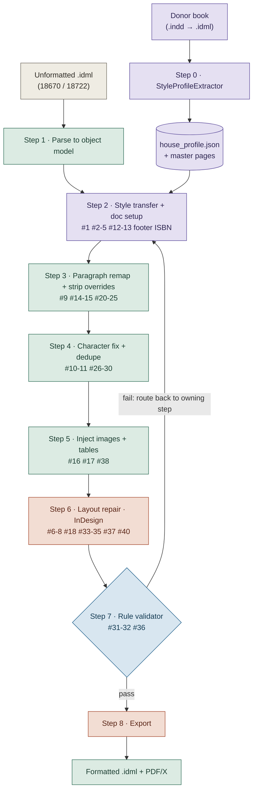

# IDML Formatting Automation — Double Nine Books

Automated formatting of unformatted InDesign books (IDML) into print-ready,
PDF/X-compliant titles. One **donor** book produces a shared style profile,
**Chapter 1** proves the rulebook, and the same rules then format every chapter
and every book automatically.

> **Legend** — `[cfg]` authored / extracted once · `[py]` Python (deterministic XML) ·
> `[jsx]` JSX (needs live InDesign) · `[val]` validator (rules replace the reference)

---

## Project layout

```
idml_automation/
├── idml_input_files/        # unformatted books to process
│   ├── 18670.idml
│   └── 18722.idml
├── epub_input_files/        # matching EPUBs (source of clean text / structure)
│   ├── 18670.epub
│   └── 18722.epub
├── reference_idml_files/    # donor / reference books (already formatted)
│   ├── 17584 More Toasts.indd
│   └── 17634 The Care And Feeding Of Children.indd
└── README.md
```

**Note on the donors:** the reference files are `.indd`. The extractor needs IDML,
so each donor is exported `.indd → .idml` once (via InDesign / JSX) before
`StyleProfileExtractor` reads it. All books share the same 38-style Double Nine
catalog, so **one** donor profile serves every input book.

---

## Architecture at a glance



**Reading it:** the donor (left) is extracted **once** into `house_profile.json`.
Each unformatted book flows down the spine; Steps 2–5 are deterministic Python,
Step 6 and 8 need InDesign, and Step 7's validator routes any failure back to the
step that owns it. Colours: purple = authored/extracted once · green = Python ·
orange = JSX/InDesign · blue = validator.

---

## 1 · Where the `profile.json` comes from

You never hand-write it. One **donor book** (any already-formatted Double Nine
title) is read once by the extractor, which writes `house_profile.json`. Because
every book shares the same named styles, that one profile is valid for Chapter 1,
the whole book, and every other book. The profile is produced upstream; Chapter 1
only **consumes** it.

```
Donor (.indd → .idml)  →  StyleProfileExtractor  →  house_profile.json + master pages  →  reused everywhere
```

**Why name-matching is safe:** the extractor keys every value by style name
(`body_text`, `chapter_name`, `blockquote_italic`…). Transfer into an unformatted
book is a dictionary merge *by name* — no fuzzy guessing — because all books speak
the same style vocabulary. This only holds within one house style.

### Profile schema

```jsonc
{
  "document": {
    "pageWidth": "129mm", "pageHeight": "198mm",
    "margins": {"top":"14mm","bottom":"16mm","inside":"16mm","outside":"12mm"},
    "bleed": "3mm", "baselineGrid": "12pt"
  },
  "paragraphStyles": {
    "body_text":    { "font":"Adobe Garamond Pro", "size":"11pt", "leading":"14pt",
                      "firstLineIndent":"4mm", "align":"justify" },
    "chapter_name": { "font":"...", "size":"24pt", "align":"center" }
    /* every named style the catalog defines */
  },
  "characterStyles": {
    "italic":      { "fontStyle":"Italic" },
    "boldtext":    { "fontStyle":"Bold" },
    "italicalign": "MERGE_INTO:italic"            // dedupe rule, #28
  },
  "masterSpreads": "templates/master_ub2.xml",     // footer + folio, #37
  "rules": {
    "normalToBody": true,                          // #9  remap Word orphans
    "stripLocalJustify": true,                     // #21 unwanted justify
    "chapterNumberSplit": "^(\\d+)\\s+(.+)$",       // #14 run-on split
    "imageMarker": "###Insert (image\\d+\\.\\w+) here###",  // #16
    "imageDPI": 300                                // #38
  }
}
```

---

## 2 · The pipeline — eight steps

Every listed issue lands in exactly one step. Steps run top to bottom; a failed
validator rule loops back to the step that owns it.

| Step | Name | Does | Issues |
|------|------|------|--------|
| **0** `[cfg]` | Extract donor → profile | Read donor once, emit `house_profile.json` + master template. Once per house style. | produces the reference |
| **1** `[py]` | Parse to object model | `IDMLPackage` unzips & parses → `Document · Styles · Stories · Spreads`. | foundation |
| **2** `[cfg]` | Style transfer + doc setup | Overwrite each named style with donor's values; copy margins, bleed, baseline grid, master pages; fix ISBN. Text/tags untouched. | #1, #2–5, #12–13, footer, ISBN |
| **3** `[py]` | Paragraph remap + strip overrides | `Normal`→`body_text`, map headings/blockquote/lists, split run-on chapter lines, strip local align/indent overrides. | #9, #14–15, #20–25 |
| **4** `[py]` | Character fix + dedupe | Merge duplicate bold/italic/underline/caps styles, make them apply, restore super/subscript, merge adjacent runs. | #10–11, #26–30 |
| **5** `[py]` | Inject images + tables | Replace `###Insert imageNNN here###` with linked frames at 300 DPI; build/verify tables. | #16, #17, #38 |
| **6** `[jsx]` | Layout repair (InDesign) | Fix overset (add pages + autoflow), baseline grid, bottom-align, even page count, remove blanks, pull up orphan chapter-end lines. | #6–8, #18, #33–35, #37, #40 |
| **7** `[val]` | Rule validator | No overset · even pages · every style resolved · every image linked · no blanks · para count stable. Failure routes back. | #31–32, #36 |
| **8** `[jsx]` | Export | Formatted `.idml` + PDF/X-compliant PDF. | #39 |

Steps 2–5 fix ~70% of the list as pure Python by re-mapping to the styles already
inside each file and stripping Word-import overrides. Only overset, baseline,
tables, even/blank pages and PDF/X need InDesign.

---

## 3 · Fix one chapter first, then apply to all

Perfect Chapter 1, and the fixes carry to other chapters and books — on one
condition:

> **Every Chapter 1 fix must change a style or a rule, never a single paragraph
> by hand.** A rule change fixes one spot *and* every matching spot everywhere;
> a manual nudge propagates to nothing.

```
Isolate ch.1  →  Fix as a rule  →  Verify ch.1  ↺  Rulebook proven  →  Run whole book  →  Run next book
```

A scope switch runs any step on one chapter first, then everything — same code:

```bash
python cli.py --book 18670 --scope chapter:1   # golden chapter: iterate here
python cli.py --book 18670 --scope all         # whole book: same rules
python cli.py --book 18722 --scope all         # next book: same rules
```

Chapters are found by `chapter_name` paragraphs. "Chapter 1" = from the 1st to the
2nd marker; transforms and the validator run only on that range.

**Chapter 1 is not where you fix the book — it's where you build and prove the
rulebook.** A new book that exposes a missed case adds one rule; the rulebook
grows, never shrinks.

### What propagates, what doesn't

| Category | Example | Propagates? |
|----------|---------|-------------|
| Style definition | body font/size/leading/indent | Yes — every paragraph of that style |
| Transform rule | strip justify override, restore italic | Yes — every chapter, every book |
| Structural rule | chapter number/title split | Yes — wherever the pattern matches |
| Per-page physical fix | one image's bottom-align (#33) | No — human decision; validator flags it |
| Book-specific remap | 18722's over-tagged `chapter_name01` | Only that book — add one scoped rule |

---

## 4 · Repository shape

```
profile/                   # [cfg] authored / extracted once
  StyleProfileExtractor
  house_profile.json
  templates/master_*.xml

package/      IDMLPackage              # [py] per-book pipeline
model/        Document, Style, Run
setup/        StyleTransfer, DocSetup
transform/    ParagraphRemapper
              CharacterFixer, Deduper
              ImageInjector, TableFit
bridge/jsx/   reflow.jsx               # [jsx] needs InDesign
              baseline.jsx, export.jsx
validate/     Validator, rules/*.py    # [val] one rule file per issue
cli.py        runs steps 0→8, scope-aware
```

Each issue becomes one named rule file under `rules/` with its own test. Fixing
"unwanted justify" means editing `strip_justify_override.py` once — and it runs
over every paragraph in every book. That is the mechanism behind
"fix once, fixes everywhere."

---

## Current input books

| Book | Chars | Images | `Normal` orphans | Notes |
|------|-------|--------|------------------|-------|
| 18670 | ~276K | 44 | 65 | needs image folder for step 5 |
| 18722 | ~1,018K | 0 | 11 | text-only; investigate 2,428 `chapter_name01` mis-tags |

Both share the pattern: one giant story crammed into ~7 pages → massive overset
(step 6 is the unblocker). Same catalog, same pipeline; only the per-book config
(image folder, book-specific remap rules) differs.

---

*Engine-dependent steps (6, 8) require InDesign; everything else runs headless in
Python and is unit-testable.*
